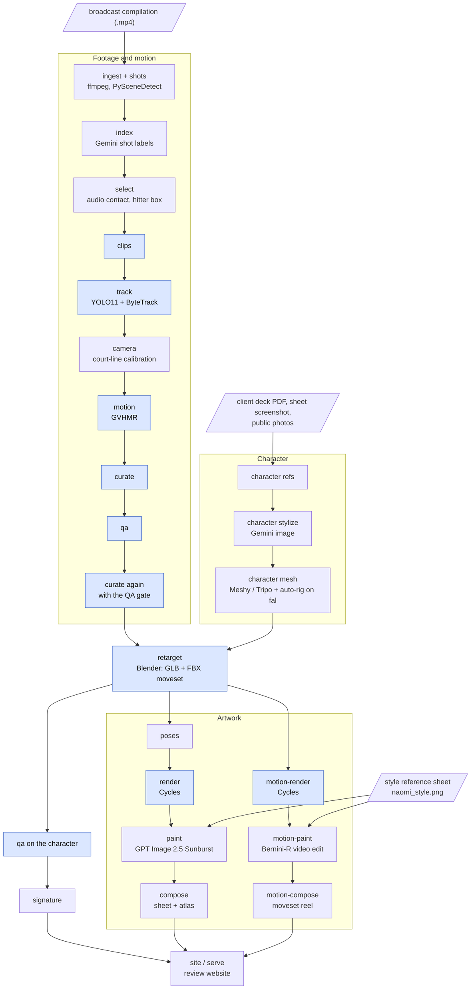

# rybakina3d

`rybakina3d` turns broadcast tennis footage of Elena Rybakina and a set of reference photos into a stylized,
rigged, game-ready 3D character. Each of its animations is recovered from one of her real strokes. The pipeline
recovers world-grounded SMPL-X motion with GVHMR on court-line-calibrated cameras and retargets it onto the rig
in Blender. It then draws the character up as a character sheet and a moveset atlas in a client-supplied art
style, renders every clip as a video, and collects all of it on a local review website.

One Typer CLI, `r3d`, has one sub-command per stage. Stages that call hosted APIs (Gemini for video and image
understanding and for the stylized character images, fal for image, 3D and video models) run on the workstation.
GPU stages run on a remote Linux host through `r3d remote <stage>`.

The same captured strokes can drive a second character. `configs/naomi.yaml` builds the art team's Naomi Osaka
character as a *variant* of this run (under `runs/rybakina/variants/naomi/`) and plays Rybakina's moveset on it.
Its deliverable is the moveset rendered for Meta Quest 3: every clip at one eye's 2064×2208 and 60 fps, render
only, plus a reel of all clips on the same canvas. See [docs/character.md](docs/character.md#5-a-character-drawn-by-the-art-team-the-naomi-variant)
and [docs/artwork.md](docs/artwork.md#4-render-profiles-the-quest-3-set).

## Results

These numbers come from the current run (`runs/rybakina/`, 2026-10-22). The run folder is not in the repository
(see [Private inputs](docs/setup.md#private-inputs)). [docs/artwork.md](docs/artwork.md) describes the images and
videos.

| Output | Current run |
|---|---|
| Footage | a 30.8 min shot compilation, 1920×1080 at 25 fps, cut into 283 shots. Gemini labelled 255 of her strokes. 68 shots are usable (allowed camera view, real time, she is on the near side or alone in frame, full body, quality ≥ 3), and they hold 142 of those strokes |
| Selection | 39 clips from 124 candidates: 12 serves, 12 forehands, 12 backhands, 2 overheads, 1 slice. No volley or celebration came from a usable shot. On 38 clips the contact frame snapped to the strike sound |
| Camera | 38 of 39 clips calibrated from the court lines. The one side-view clip is not calibrated (by design) |
| Motion | 39 of 39 clips recovered with GVHMR 1.6.1, 38 of them on the court calibration |
| Curation | `curate.keep_all: true` keeps all 39 clips. 24 pass the stroke check and 15 are flagged because their motion contradicts the label: 6 serves and 1 overhead never raise the hitting wrist 0.25 m above the head, and 8 groundstrokes never reach 4 m/s of hand speed near contact |
| QA | 7 PASS, 22 WARN, 10 FAIL. All 10 FAILs are timing rules on flagged clips: the wrist-speed peak is more than 8 frames from the contact, or there is no swing |
| Moveset | `anim/rybakina_moveset.glb` (8.44 MB) and `.fbx` (15.16 MB). 39 animations (2,531 frames at 25 fps); 25,004 triangles (character 24,588 + racket 416); 24 bones (Meshy humanoid rig, no fingers). Re-import check passed: every clip replays its joint track within 0.011 mm |
| Foot skate | the character's feet on planted frames: median 1.07 cm/frame before retarget foot planting, 0.11 after |
| Signature | per-stroke biomechanics (contact height, knee flex, hip–shoulder separation, stance, toss) on the 24 label-checked clips |
| Character sheet | `artwork/rybakina_character_sheet.png`, 3840×2560. All 10 paintable figures were repainted and accepted (silhouette IoU 0.85–0.98); the 6 silhouettes come from the render mattes. A render-only twin sits next to it |
| Moveset atlas | `artwork/rybakina_moveset_atlas.png`, 3840×2560: all 39 clips at contact, grouped by stroke, flagged clips marked |
| Motion videos | 39 clip videos and a turntable, 1024×1024 at 25 fps (Cycles, 48 samples, about 59 min on one A100). The moveset reel `artwork/motion/rybakina_moveset_reel.mp4` is 1920×2114, a 5.2 s loop with all contacts aligned |
| Painted motion | the full `motion-paint` run was still in progress when this was written (snapshot in [docs/artwork.md](docs/artwork.md#motion-paint)). During development, a smoke test on one forehand gave per-frame silhouette IoU median 0.96 (p10 0.90) and racket recall 1.0. **Placeholder, maintainer to replace from `artwork/motion/painted/paint.json` (`accepted`, `n`, `cost_usd`): N of 39 clips accepted, USD X.** The reel uses the render for every tile that has no accepted painted clip |
| Naomi variant | `variants/naomi/anim/naomi_moveset.glb` (17.41 MB) and `.fbx` (33.10 MB): the same 39 animations on the art team's Naomi Osaka, built from their renders (front + three Sunburst views) by Hi3D v3.0 and Meshy's auto-rig, 280,416 triangles with the racket, 54 bones (the auto-rig's 24 and 15 finger bones per hand: the racket seated on the palm, the left hand put on the handle by IK in two-handed strokes), vertices welded (840k → 140k) so knees bend as one skin, each knee's thigh/shin weight split re-centred on the joint (`retarget.leg_weights: band`: the auto-rig's handover sat about 5.5 cm below the joint behind the knee, so deep bends collapsed the back of the calf). Meshy 7.1 and Hunyuan3D 3.1 Pro were tried first ([docs/character.md](docs/character.md#5-a-character-drawn-by-the-art-team-the-naomi-variant)) |
| Quest 3 set | render profile `quest3`: 2064×2208, 60 fps, 16 samples, H.264 High@5.2, CRF 16, render only. Naomi's Hi3D set is complete: 39 clips, 6,065 frames, rendered on one A100 by `DETACH=1 scripts/render_quest3.sh` in 10 batches of 4, 6 h 47 min from the first batch to the rebuilt site (2.56 s Cycles + 1.07 s matte a frame, 6.4 h of Blender time, encoding beside it). The 39 videos are 76.4 MB (0.92 to 3.01 MB each); the reel `variants/naomi/artwork/motion/naomi_moveset_reel_quest3.mp4` is 3.96 MB, a 5.2 s loop of all 39 clips. The `draft` profile (516×552, 16 samples) previews it. `quest3` and `draft` render with `smooth_skin` (dual-quaternion skinning + Corrective Smooth) |

## How it works



Blue stages run on the GPU host through `r3d remote`, and all others run on the workstation.
[docs/architecture.md](docs/architecture.md) explains the run-folder contract and the split between the two
machines.

## Quickstart

Full instructions are in [docs/setup.md](docs/setup.md). In short:

```bash
# 1. workstation: Python >= 3.11, uv, ffmpeg
uv venv --python 3.12 .venv && uv pip install -e ".[api,dev]"

# 2. secrets and the GPU host go in .env in the project root (never committed, never synced):
#      GEMINI_API_KEY=...
#      FAL_KEY=...              (or FAL_API=...)
#      R3D_HOST=user@gpu-host

# 3. private inputs (not in the repository) go in the project root:
#    Elena-Rybakina-Shots.mp4, the client deck PDF, the sheet screenshot, naomi_style.png
#    (exact names and their uses: docs/setup.md#private-inputs)

# 4. GPU host, once: push the code and the source video, then install there
export R3D_HOST=user@gpu-host                     # sync.sh reads the environment; r3d also reads .env
scripts/sync.sh
rsync -P Elena-Rybakina-Shots.mp4 "$R3D_HOST:rybakina3d/"
ssh "$R3D_HOST"                                   # then, on the host:
#   cd ~/rybakina3d && bash scripts/setup_gpu.sh  # Blender 5.2 is installed separately

# 5. run every stage in order (FROM=<stage> resumes)
scripts/run_pipeline.sh
# its artwork stage ends with the moving artwork; to run only that part:
.venv/bin/r3d remote artwork motion-render
.venv/bin/r3d artwork motion-paint
.venv/bin/r3d artwork motion-compose
.venv/bin/r3d site

# 6. review at http://127.0.0.1:8765
.venv/bin/r3d serve

# a character variant's Quest 3 set: render, compose and publish in batches (docs/setup.md#a-character-variant)
scripts/render_quest3.sh

# tests (170; no GPU, Blender, network or private inputs) and lint. Tests that encode video skip without ffmpeg
.venv/bin/pytest -q && .venv/bin/ruff check src tests
```

## Stages

`.venv/bin/r3d --help`, `r3d character --help` and `r3d artwork --help` list the commands. All outputs are
under `runs/rybakina/` (`run_dir` in `configs/rybakina.yaml`). A variant's `character/`, `anim/` and `artwork/`
outputs are under `runs/rybakina/variants/<name>/`, with `<name>_` in place of `rybakina_` (`<stem>` below).

| Stage | Where | Models / tools | What it does | Output |
|---|---|---|---|---|
| `ingest` | workstation | ffmpeg | probes the source, extracts 16 kHz mono audio and builds the 360p upload proxy (keeps an existing audio track and proxy) | `source/probe.json`, `audio16k.wav`, `proxy.mp4` |
| `shots` | workstation | PySceneDetect `AdaptiveDetector` | finds hard cuts on the proxy | `shots.json` |
| `index` | workstation | `gemini-3.8-flash` | labels each shot in 240 s windows at 2 fps: camera view, replay / slow motion, her court side, full body, quality 1–5, outfit, every stroke with its contact time | `index/index.json`, `index/chunk_*.json` |
| `select` | workstation | librosa onsets, `gemini-3.8-flash` | snaps contact to the strongest strike onset within ±0.5 s, locates her box on the contact frame, ranks windows and keeps `oversample` (×2) × the quota per stroke | `selection.json`, `index/locate.json` |
| `character refs` | workstation | PyMuPDF, Wikimedia Commons API | collects identity and style references from the client deck, the sheet screenshot and four Commons photos | `character/refs/` |
| `character stylize` | workstation | `gemini-3-pro-image` | generates a front A-pose hero in the target style, then a four-view turnaround conditioned on the hero, and cuts the views out | `character/sheet/` |
| `character mesh` | workstation | fal `fal-ai/meshy/v7.1/multi-image-to-3d` (primary, with built-in rig); `tripo3d/h3.1/multiview-to-3d` + `fal-ai/meshy/rigging` (A/B) | builds a quad mesh at the `target_tris` budget and a humanoid auto-rig | `character/mesh/`, `character/rigged.glb` |
| `character face` | workstation | Blender (local), OpenCV YuNet | optional, for an art-team variant: projects the art team's front headshot onto the rig's face and bakes it into the base colour (not used for Naomi) | `character/face/`, `character/rigged.glb` |
| `clips` | GPU host | ffmpeg | makes frame-exact cuts: a model copy (every source frame, restamped at 30 fps) and a 720p review copy at the source rate | `clips/<id>/clip.json`, `clip.mp4` (stays on the host), `preview.mp4` |
| `track` | GPU host | YOLO11x + ByteTrack | picks her track by the hitter box, repairs id switches, interpolates and smooths | `clips/<id>/track.npz`, `track.jpg` |
| `camera` | workstation | numpy / OpenCV, ITF court model | calibrates per-frame focal length and pose from the court lines on `preview.mp4`, with a fixed-centre clip bundle. Only `main_broadcast` and `behind_low` views are calibrated | `clips/<id>/camera.npz`, `camera.jpg` |
| `motion` | GPU host | GVHMR 1.6.1 (ViTPose; SimpleVO only for an uncalibrated moving camera) | recovers world-grounded SMPL-X from our boxes, our camera and full-resolution crops, on GVHMR's own world trajectory | `clips/<id>/motion.npz`, `overlay.mp4` (`gvhmr/` stays on the host) |
| `curate` | GPU host (pure numpy) | — | checks the motion against the label (serve / overhead: wrist ≥ 0.25 m above the head; groundstroke: hand ≥ 4 m/s near contact), refines contact into `clip.json` (idempotent) and ranks per stroke. With `keep_all` it keeps every clip and only flags failures | `curation.json` |
| `qa` | GPU host (pure numpy) | — | scores foot skate, ground contact, jitter, reprojection against ViTPose, swing timing and tracking, plus the character's own skate once retargeted, as PASS / WARN / FAIL | `clips/<id>/qa.json`, `qa_summary.json` |
| `retarget` | GPU host | Blender 5.2 (headless) | transfers world rotations onto the rig with rest-pose alignment, plants the feet from GVHMR contacts, adds a procedural racket on `RightHand`, exports one action per clip, then re-imports in a fresh Blender as a gate and renders check stills | `anim/rybakina_moveset.glb`, `.fbx`, `retarget.json`, `verify.json`, `joints/`, `checks/` (`.blend` stays on the host) |
| `signature` | workstation | numpy | measures her stroke signature on the label-checked clips | `signature.json` |
| `artwork poses` | workstation | numpy | resolves every sheet slot (`artwork/layout.py`) to a clip, frame and camera from the retargeted joint tracks | `artwork/poses.json` |
| `artwork render` | GPU host | Blender Cycles (OptiX, 128 samples) | renders each slot and every clip at contact as RGBA with a soft contact shadow, plus a figure-only matte | `artwork/renders/` |
| `artwork paint` | workstation | fal `openai/gpt-image-2.5/sunburst/edit` | repaints each paintable figure in the reference style. A repaint is accepted only when its silhouette matches the render (`ACCEPT_IOU = 0.85`); otherwise the render stays | `artwork/painted/` |
| `artwork compose` | workstation | Pillow | lays out the sheet like `naomi_style.png`, a render-only twin and the moveset atlas | `artwork/rybakina_character_sheet.png`, `rybakina_character_sheet_render.png`, `rybakina_moveset_atlas.png`, `artwork.json` |
| `artwork motion-render` | GPU host | Blender Cycles (48 samples), ffmpeg | renders every clip's action and a turntable over the sheet's paper, with a matte video for the pose check. `--profile quest3` renders the clips at 2064×2208, 60 fps, 16 samples instead (render only; `draft` is a quarter-size preview), `--clip` limits the clips | `artwork/motion/render/`, `render_quest3/`, `render_draft/` (PNG frames stay on the host) |
| `artwork motion-paint` | workstation | fal: GPT Image 2.5 Sunburst (frame 0), `fal-ai/bernini-r/reference-edit-video`, `fal-ai/birefnet/v2/video` (matting) | paints frame 0 like a sheet figure and carries it through the clip with the video model. A clip is accepted only when its per-frame silhouettes (median and 10th percentile) and the racket still match the render | `artwork/motion/painted/` |
| `artwork motion-compose` | workstation | ffmpeg | builds the moveset reel: every clip in an 8-column grid, contacts aligned, looping, painted where accepted, plus an all-render twin. `--profile quest3` / `draft` builds one render-only reel on the fixed 2064×2208 canvas | `artwork/motion/rybakina_moveset_reel.mp4`, `rybakina_moveset_reel_render.mp4`, `rybakina_moveset_tiles/`, `motion.json`; `<stem>_moveset_reel_<profile>.mp4`, `<stem>_moveset_tiles_<profile>/`, `motion_<profile>.json` |
| `site` / `serve` | workstation | three.js (from jsDelivr) in the page | builds a static review site of symlinks into the run folder, served with Range support | `site/` → http://127.0.0.1:8765 |
| `publish` | GPU host (over ssh) | `cloudflared` quick tunnel | sends the code and the run results up, rebuilds the site on the host, serves it there and prints a public `trycloudflare.com` URL (see [docs/review-site.md](docs/review-site.md#sharing-the-site-r3d-publish)) | the host's `site/` and `logs/` |

`scripts/run_pipeline.sh` runs `ingest shots index select character clips track camera motion curate qa curate2
retarget qa2 signature artwork site`. The first `curate` fixes labels and contact frames from the motion,
because `qa`'s timing rules need the refined contact. `curate2` repeats it with the QA gate, and `qa2` scores the
retargeted character. `artwork` runs `poses`, `remote artwork render`, `paint` and `compose`, then
`remote artwork motion-render`, `motion-paint` and `motion-compose` at the `web` profile. Re-run and
`--force` semantics are covered in [docs/setup.md](docs/setup.md#running-stages).

## Documentation

| Document | Covers |
|---|---|
| [docs/setup.md](docs/setup.md) | workstation and GPU-host setup, `.env`, private inputs, running and resuming stages, running a character variant and `scripts/render_quest3.sh`, configuration and `extends`, time, disk and cost, troubleshooting |
| [docs/architecture.md](docs/architecture.md) | the package layout, the run-folder contract (`config.py` `RunLayout`, its `root` and `out`), render profiles, the workstation / GPU-host split |
| [docs/motion-pipeline.md](docs/motion-pipeline.md) | footage to moveset: index, select, track, camera calibration, GVHMR, curate, QA, retarget, signature |
| [docs/character.md](docs/character.md) | references, stylized hero and turnaround, mesh and rig, the Naomi variant |
| [docs/artwork.md](docs/artwork.md) | the character sheet, the moveset atlas, the motion videos and the painted versions, the render profiles and the Quest 3 reel |
| [docs/review-site.md](docs/review-site.md) | the review website: build, serve, pages, data, the variant sections, sharing it with `r3d publish` |

## Repository layout

```
configs/rybakina.yaml        athlete, models, thresholds, quotas, GPU host root and Blender path
configs/naomi.yaml           the Naomi variant: `extends: rybakina.yaml`, its own character settings, the hand settings
configs/rybakina_5s.yaml     the 5 s experiment: one clip through the whole pipeline in runs/rybakina_5s
configs/naomi_5s.yaml        the Naomi variant on that clip with the hands as before them (the A/B baseline)
configs/naomi_5s_grip.yaml   the same with the hand settings on, in runs/rybakina_5s_grip
src/rybakina3d/
  config.py                  typed config + RunLayout / ClipLayout (the on-disk contract between stages)
  cli.py                     `r3d`: one sub-command per stage, `r3d remote <stage>`
  remote.py                  push code + run inputs to the GPU host, run a stage over ssh, pull results; publish
  footage.py                 ingest + shots
  index/                     labeler.py (Gemini shot labels), schema.py (their structure)
  selection.py clips.py tracking.py camera.py
  motion/                    recover.py (GVHMR), smpl.py (skeleton, joint indices, FK)
  curate.py qa.py signature.py
  character/                 refs.py stylize.py mesh.py, art.py (art-team variants), face.py,
                             hands.py (finger rig and racket seat from the hand mesh)
  assemble.py                retarget driver: Blender job, check sheets, re-import gate
  artwork/                   layout.py (the sheet, render profiles) poses.py render.py paint.py compose.py
                             motion_render.py motion_paint.py motion_compose.py
  blender/                   retarget.py racket.py artwork.py artwork_motion.py face_project.py
                             fingers.py (finger bones, palm seat) twohand.py (left hand on the racket)
                             (run inside Blender: bpy + numpy)
  site.py                    review site build + server
  gemini.py fal.py           hosted-model clients
  gltf.py media.py util.py   GLB stats, ffmpeg wrappers, logging / io / secrets
web/                         static review front-end (copied into site/)
scripts/                     run_pipeline.sh, sync.sh, setup_gpu.sh, render_quest3.sh
tests/                       unit tests on synthetic data (no GPU, Blender or network)
docs/                        the documents above
```

Gitignored and therefore missing from a clone: `.env`, `runs/`, the source video (`*.mp4`), the client deck
(`*.pdf`), `Screenshot*.png`, `/naomi_style.png`, `/assets/`, the art team's `/artexamplesfortennisnaomiosaka/`,
and the folders `bin/`, `weights/` (GVHMR and YOLO on the GPU host, YuNet for `character face` on the workstation)
and `body_models/`.

## Known limitations

- Only real-time, near-court, full-body shots are captured. Replays, far-court and close-up shots are excluded,
  which leaves 68 of 283 shots, and the compilation yields no volley or celebration clip.
  See [docs/motion-pipeline.md](docs/motion-pipeline.md).
- Stroke labels come from a model. 15 of the 39 clips contradict their label in 3D (the 6 flagged "serves" are
  most likely returns of serve); they stay in the moveset, flagged, and are left out of the signature.
- Depth from a single broadcast view is the weak axis: about 65 % of the remaining raw foot skate runs along the
  camera ray. The side-view clip has no court calibration and uses an assumed lens.
- Feet are planted at retarget without heel/toe IK, so the lowest foot can dip about 3 cm into the court
  (5th percentile).
- The racket is a rigid prop on `RightHand` that follows GVHMR's wrist; racket face and forearm roll are not
  measured. On Rybakina's two-handed backhands the left hand is not constrained to the handle.
- The Meshy auto-rig has 24 bones and no fingers or face controls. On Rybakina the grip is not articulated (the
  repaints paint closed hands), and the sheet's four head close-ups are four angles, not four expressions. Hair and
  dress are skinned, with no cloth or hair simulation. Naomi's moveset (`configs/naomi.yaml`) adds 30 finger bones
  and IKs the left hand onto the handle ([docs/character.md](docs/character.md#4-the-racket)); when it takes hold
  is read from GVHMR's wrist distance, and the grip is one pose solved on the handle, not measured per stroke.
- Repaints and painted videos depend on hosted models. A figure or clip that misses its silhouette check falls
  back to the render, and an endpoint can close: Kling v4 edit was closed to API callers on 2026-10-22.
  `models.video_paint` is Bernini-R, the model that kept the motion best in a smoke test, and `motion-paint` drives
  no other. See [docs/artwork.md](docs/artwork.md).
- `src/rybakina3d/character/refs.py` reads the client deck and the screenshot by exact file name and has no option
  to skip them, so `character refs` cannot run on a clone without them.
- The workstation side has only been run on macOS. `artwork compose` prefers macOS system fonts and falls back
  to DejaVu, and `character mesh` looks for Blender at `/Applications/Blender.app` unless `R3D_BLENDER_LOCAL` is
  set. See [docs/setup.md](docs/setup.md).
