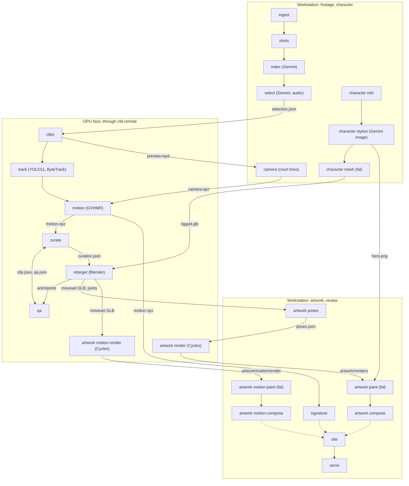

# Architecture

This document explains how `rybakina3d` is built. It covers the pipeline as a set of idempotent CLI stages over one run folder, how the package is layered, the on-disk contract between those stages (`RunLayout` / `ClipLayout` in `src/rybakina3d/config.py`), the split between the workstation and the GPU host, how each stage decides that its work is already done, configuration and secrets, the hosted-model and Blender conventions, the tests, and what to change when you add a stage.

Related documents:

- [setup.md](setup.md): installation, `.env`, the private inputs, and how to run and resume stages.
- [motion-pipeline.md](motion-pipeline.md), [character.md](character.md) and [artwork.md](artwork.md): the design and results of the stages themselves.
- [review-site.md](review-site.md): the review website.
- [game-handoff.md](game-handoff.md): what the moveset files hold for a game engine and what a game team would still need.

## Principles

- **One stage, one command.** Every pipeline step is an `r3d` sub-command defined in `src/rybakina3d/cli.py`. A command imports its stage module inside the function, so `r3d --help` and the API stages work on a workstation without torch, and the GPU host needs none of the API client libraries.
- **Files are the only interface.** Stages talk to each other only through files in one run folder (`runs/rybakina/` by default). Every shared path is a property of `RunLayout` or `ClipLayout`. A few stages also keep their own index file inside their own folder, for example `artwork/renders/renders.json` or `artwork/painted/paint.json`.
- **Re-runnable at any time.** A stage either skips work whose outputs already exist (or whose fingerprint still matches), or it cheaply rewrites its outputs. `--force` recomputes. Interrupting a stage and starting it again is the normal way to resume.
- **The order lives in one script.** `scripts/run_pipeline.sh` only lists the stages in order and says which machine runs each one. It holds no logic of its own.
- **Review is a read-only view.** `r3d site` rebuilds the review website from whatever exists in the run folder, at any point, including while stages are still running. Missing outputs show as pending. See [review-site.md](review-site.md).

## Stages



The dotted edges into `site` stand for "reads everything". The site also reads the outputs of every other stage.

| Command | Runs on | Module | Main outputs (under the run folder) |
|---|---|---|---|
| `r3d ingest` | workstation | `footage.py` | `source/probe.json`, `source/audio16k.wav`, `source/proxy.mp4` |
| `r3d shots` | workstation | `footage.py` | `shots.json` |
| `r3d index` | workstation (Gemini) | `index/labeler.py` | `index/index.json` |
| `r3d select` | workstation (Gemini) | `selection.py` | `selection.json` |
| `r3d character refs` | workstation | `character/refs.py` | `character/refs/` |
| `r3d character stylize` | workstation (Gemini image) | `character/stylize.py` | `character/sheet/` |
| `r3d character mesh` | workstation (fal) | `character/mesh.py` | `character/mesh/`, `character/rigged.glb` |
| `r3d character face` | workstation (local Blender, YuNet) | `character/face.py`, `blender/face_project.py` | `character/face/`, a new base colour in `character/rigged.glb` (optional, art-team variants) |
| `r3d remote clips` | GPU host | `clips.py` | `clips/<id>/clip.json`, `clip.mp4`, `preview.mp4` |
| `r3d remote track` | GPU host | `tracking.py` | `clips/<id>/track.npz`, `track.jpg` |
| `r3d camera` | workstation | `camera.py` | `clips/<id>/camera.npz`, `camera.jpg` |
| `r3d remote motion` | GPU host | `motion/recover.py` | `clips/<id>/motion.npz`, `overlay.mp4`, `gvhmr/` |
| `r3d remote curate` | GPU host (numpy) | `curate.py` | `curation.json`, refined contact in `clip.json` |
| `r3d remote qa` | GPU host (numpy) | `qa.py` | `clips/<id>/qa.json`, `qa_summary.json` |
| `r3d remote retarget` | GPU host (Blender) | `assemble.py`, `blender/retarget.py`, `blender/racket.py`; with the hand settings also `blender/fingers.py`, `blender/twohand.py` and `character/hands.py` | `anim/`; with the hand settings `character/hand_rig.json` (+ `.npz`) when it is not fresh |
| `r3d signature` | workstation | `signature.py` | `signature.json` |
| `r3d artwork poses` | workstation | `artwork/poses.py` | `artwork/poses.json` |
| `r3d remote artwork render` | GPU host (Blender Cycles) | `artwork/render.py`, `blender/artwork.py` | `artwork/renders/` |
| `r3d artwork paint` | workstation (fal) | `artwork/paint.py` | `artwork/painted/` |
| `r3d artwork compose` | workstation | `artwork/compose.py` | `artwork/rybakina_*.png`, `artwork/artwork.json` |
| `r3d remote artwork motion-render [--profile P]` | GPU host (Blender Cycles) | `artwork/motion_render.py`, `blender/artwork_motion.py` | `artwork/motion/render/` (web), `artwork/motion/render_<P>/` |
| `r3d artwork motion-paint` | workstation (fal) | `artwork/motion_paint.py` | `artwork/motion/painted/` |
| `r3d artwork motion-compose [--profile P]` | workstation | `artwork/motion_compose.py` | `artwork/motion/rybakina_moveset_reel*.mp4`, `rybakina_moveset_tiles/`, `motion.json` (web); `<stem>_moveset_reel_<P>.mp4`, `<stem>_moveset_tiles_<P>/`, `motion_<P>.json` |
| `r3d site`, `r3d serve` | workstation | `site.py` | `site/` |
| `r3d publish` | GPU host, started from the workstation | `remote.py` (`publish`) | on the host: `site/`, `logs/` (see [review-site.md](review-site.md#sharing-the-site-r3d-publish)) |

Each module's docstring is the design note for that stage: what it computes, why, and the exact contract of its outputs. For example, `motion/recover.py` documents every array in `motion.npz`, and `camera.py` documents every array in `camera.npz`.

### Package layers

The [README](../README.md#repository-layout) lists every file. The dependencies point one way:

| Layer | Modules | May import |
|---|---|---|
| Contract and helpers | `config.py` (Config, RunLayout, ClipLayout), `util.py` (log, JSON / npz I/O, secrets), `media.py` (ffmpeg / ffprobe), `gltf.py` (GLB stats without dependencies) | nothing from the stages |
| Hosted-model clients | `gemini.py`, `fal.py` | the helpers |
| Stages | `footage.py`, `index/`, `selection.py`, `clips.py`, `tracking.py`, `camera.py`, `motion/`, `curate.py`, `qa.py`, `signature.py`, `character/`, `assemble.py`, `artwork/` | helpers, clients, and the pure functions and constants of other stages (for example `artwork/compose.py` reuses `paint.py`, and `site.py` reuses `curate.py`'s thresholds) |
| Blender scripts | `blender/*.py` | only `bpy`, `mathutils`, `bmesh`, numpy and each other; never `rybakina3d` |
| Entry points | `cli.py` (`r3d`), `remote.py` (`r3d remote`), `site.py` (`r3d site` / `serve`) | everything, with stage modules imported lazily |
| Front-end | `web/` (HTML, ES modules, CSS; no build) | only `site/data/` and `site/media/` over HTTP |

### Run order

`scripts/run_pipeline.sh` runs:

```
ingest shots index select character clips track camera motion curate qa curate2 retarget qa2 signature artwork site
```

- `character` runs `character refs`, then `stylize`, then `mesh`.
- `curate` runs twice. The first pass refines each clip's contact frame from the recovered motion and writes it into `clip.json`, because `qa`'s timing check measures against that contact. `curate2` then runs with the QA gate in place.
- `qa` also runs twice. `qa2` runs after `retarget` and adds the retargeted character's foot skate and jitter, read from `anim/joints/<id>.npz`.
- `artwork` runs `artwork poses`, `r3d remote artwork render`, `artwork paint` and `artwork compose`, then the three "in motion" stages at the `web` profile: `r3d remote artwork motion-render`, `artwork motion-paint` and `artwork motion-compose`.
- `FROM=<name> scripts/run_pipeline.sh` resumes at any name in the list, including `curate2` and `qa2`.

To run only the three "in motion" stages (`artwork motion-render`, `motion-paint`, `motion-compose`), for example after a new moveset:

```bash
.venv/bin/r3d remote artwork motion-render
.venv/bin/r3d artwork motion-paint
.venv/bin/r3d artwork motion-compose
.venv/bin/r3d site
```

A character variant's Quest 3 set has its own driver, `scripts/render_quest3.sh`: per batch of clips it runs `r3d remote artwork motion-render --profile quest3 --clip …`, `r3d artwork motion-compose --profile quest3` and `r3d publish`, with `R3D_CONFIG` set to the variant's config ([setup.md](setup.md#a-character-variant)).

## The run folder contract

`Config.run` is a `RunLayout` over `run_dir`, and `RunLayout.clip(id)` returns a `ClipLayout`. These two classes are the contract between stages: if a path is not a property there, other stages should not depend on it. Two helpers decide which clips a stage sees:

- `RunLayout.clip_ids()` returns the clips of the **current** `selection.json` that have been cut (they have a `clip.json`), in selection order. Folders left over from an older selection are ignored.
- `RunLayout.kept_clip_ids()` returns the clips `curate` kept, in the same order. Before `curate` has run, it returns every cut clip. This is the moveset that `retarget`, `signature` and the artwork stages work on.

In the table, `character/`, `anim/` and `artwork/` sit under `RunLayout.out`, and `rybakina_` in a file name is `RunLayout.stem` ([Character variants](#character-variants-root-and-out)). For the Rybakina config both are the run root and `rybakina`.

| Path | `RunLayout` / `ClipLayout` | Written by | Made on | Read by |
|---|---|---|---|---|
| `source/probe.json` | `probe` | ingest | workstation | shots, select, site |
| `source/audio16k.wav` | `audio` | ingest | workstation | select (audio onsets) |
| `source/proxy.mp4` | `proxy` | ingest | workstation | shots, index (uploaded to Gemini) |
| `shots.json` | `shots` | shots | workstation | index, site |
| `index/index.json` | `index` | index (with `chunk_NN.json`, `upload.json` caches) | workstation | select, site |
| `index/locate.json` | (by name) | select (hitter-box cache) | workstation | select |
| `selection.json` | `selection` | select | workstation | clips, `clip_ids()`, site |
| `clips/<id>/clip.json` | `meta` | clips; `contact_index` rewritten by curate | host | nearly every per-clip stage, site |
| `clips/<id>/clip.mp4` | `video` | clips | host | track, motion |
| `clips/<id>/preview.mp4` | `preview` | clips | host | camera, retarget check sheets, site |
| `clips/<id>/track.npz`, `track.jpg` | `track`, `track_preview` | track | host | motion, qa, site |
| `clips/<id>/camera.npz`, `camera.jpg` | `camera`, `camera_preview` | camera | workstation | motion, site |
| `clips/<id>/gvhmr/` | `gvhmr_dir` | motion | host | motion (GVHMR's cache) |
| `clips/<id>/motion.npz`, `overlay.mp4` | `motion`, `overlay` | motion | host | curate, qa, retarget, signature, site |
| `clips/<id>/qa.json` | `qa` | qa | host | curate (QA gate), site |
| `curation.json` | `curation` | curate | host | `kept_clip_ids()`, signature, artwork, site |
| `qa_summary.json` | `qa_summary` | qa | host | site |
| `signature.json` | `signature` | signature | workstation | site |
| `character/refs/`, `refs.json` | `refs_dir`, `refs` | character refs | workstation | stylize, site |
| `character/sheet/` (`hero.png`, `turnaround.png`, `views/`, `stylize.json`) | `sheet_dir`, `views_dir`, `stylize_report` | character stylize | workstation | mesh; paint and motion-paint (hero as identity); site |
| `character/mesh/<generator>/`, `mesh.json` | `mesh_dir`, `mesh_report` | character mesh | workstation | site |
| `character/rigged.glb` | `rig` | character mesh | workstation | retarget, site |
| `character/hand_rig.json`, `.npz` | `hand_rig` | retarget (`character/hands.py`, when a hand setting is on) | where retarget runs | retarget |
| `anim/rybakina_moveset.glb`, `.fbx` | `moveset_glb`, `moveset_fbx` | retarget | host | artwork render, motion-render, site |
| `anim/retarget.json` | `retarget_report` | retarget | host | artwork render and motion-render (bone mapping), site |
| `anim/joints/<id>.npz` | `joints_dir` | retarget | host | qa (second pass), artwork poses |
| `anim/checks/<id>_<frame>.jpg` | `checks_dir` | retarget | host | site |
| `anim/rybakina_moveset.blend` | `moveset_blend` | retarget | host | manual inspection only (never pulled) |
| `artwork/poses.json` | `artwork_poses` | artwork poses | workstation | artwork render, site |
| `artwork/renders/` (`renders.json`) | `artwork_renders` | artwork render | host | paint, compose |
| `artwork/painted/` (`paint.json`) | `artwork_painted` | artwork paint | workstation | compose |
| `artwork/rybakina_character_sheet.png`, `..._render.png`, `rybakina_moveset_atlas.png`, `artwork.json` | `character_sheet`, `character_sheet_render`, `moveset_atlas`, `artwork_report` | artwork compose | workstation | site |
| `artwork/motion/frames/` (`frames/<profile>/` for `quest3` and `draft`) | `motion_frames` | motion-render (PNG frames) | host | motion-render (re-encode only) |
| `artwork/motion/render/` (`renders.json`) | `motion_renders`, `motion_renders_for("web")` | motion-render | host | motion-paint, motion-compose, site |
| `artwork/motion/render_<profile>/` (`renders.json`) | `motion_renders_for(profile)` | motion-render `--profile quest3` / `draft` | host | motion-compose `--profile`, site (variants) |
| `artwork/motion/<stem>_moveset_reel_<profile>.mp4`, `<stem>_moveset_tiles_<profile>/`, `motion_<profile>.json` | (by name in `motion_compose.py`: `profile_reel`, `tiles_dir`, `profile_report`) | motion-compose `--profile quest3` / `draft` | workstation | site (variants) |
| `artwork/motion/painted/` (`paint.json`) | `motion_painted` | motion-paint | workstation | motion-compose, site |
| `artwork/motion/rybakina_moveset_reel.mp4`, `..._reel_render.mp4`, `rybakina_moveset_tiles/`, `motion.json` | `moveset_reel`, `moveset_reel_render`, `motion_report` | motion-compose | workstation | site |
| `site/` | `site_dir` | site | workstation | serve |

Notes on the contract:

- `clip.json` starts as the selection row for the clip (stroke, view, shot, hitter box, contact frame, score). `clips` adds frame counts and rates, and `curate` overwrites `contact_index`. `curate` keeps the original in `contact_index_selected`, so a re-run always starts from the contact that `select` chose and the refinement is idempotent.
- Frames are 1:1 across a clip. `clip.mp4` carries every source frame re-stamped at `clips.model_fps` (30, GVHMR's training rate). `preview.mp4`, `overlay.mp4`, `motion.npz`, the retargeted action and the web artwork videos all play at the source rate (25 fps for this footage). Frame *i* is the same instant everywhere. The `quest3` and `draft` videos are the exception: they play at 60 fps, output frame *k* shows the action at a sub-frame (`blender/artwork_motion.frame_times`), and their `renders.json` rows give the contact as an output frame and every frame's action time (`source.times`).
- Coordinate frames are documented where they are produced. SMPL quantities in `motion.npz` are Y-up metres. `camera.npz` is in court metres (Z up, origin at the court centre). Blender-side data (`anim/joints`, the renders' camera records) is Z-up.

### Character variants: `root` and `out`

`RunLayout(root, variant=None)` separates what is shared from what belongs to one character. `Config.run` passes `character.variant`.

| Attribute | Rybakina config | Variant config (`character.variant: naomi`) |
|---|---|---|
| `root` | `runs/rybakina/` | `runs/rybakina/` (the same `run_dir`) |
| `out` | `root` | `root/variants/naomi/` |
| `stem` | `rybakina` | `naomi` |

- **Under `root`, shared:** `source/`, `shots.json`, `index/`, `selection.json`, `clips/`, `curation.json`, `qa_summary.json`, `signature.json` and `site/`. A variant plays the same captured strokes and does not re-run the stages that write them.
- **Under `out`, per character:** `character/`, `anim/` and `artwork/`, with `<stem>_*` file names (`anim/<stem>_moveset.glb`, `artwork/<stem>_character_sheet.png`, `artwork/motion/<stem>_moveset_reel.mp4`, …).
- **Reports keep paths relative to `root`,** so a variant's `renders.json` says `variants/naomi/artwork/motion/render_draft/<clip>.mp4`, and the site resolves both characters' paths the same way.
- `Config.display_name` is `character.name`, else `athlete.name`: the title on a variant's artwork. `configs/naomi.yaml` inherits `athlete` unchanged, so the name in "captured from …", the handedness and the backhand are Rybakina's.
- The site builds `RunLayout(root, name)` for every folder in `root/variants/` ([review-site.md](review-site.md#character-variants)).

### Render profiles

`motion-render` and `motion-compose` take `--profile` (`artwork/layout.py` `PROFILES`: `web`, `quest3`, `draft`; see [artwork.md](artwork.md#4-render-profiles-the-quest-3-set)). `RunLayout.motion_renders_for(profile)` is the clip-video folder: `artwork/motion/render/` for `web`, `artwork/motion/render_<profile>/` otherwise. The PNG frames go to `artwork/motion/frames/` for `web` and `frames/<profile>/` otherwise (`motion_render.frames_root`). Each profile has its own `renders.json`, `job.json` and `blender.log`, and a run of one profile never reads or deletes another's files. `web` stays the input of `motion-paint` and of the web reel; `quest3` and `draft` are render only.

## Workstation and GPU host

The pipeline runs on two machines, split by what each one holds:

- **The workstation holds the secrets.** `.env` (API keys and the host address) never leaves it. Every Gemini and fal call happens in a workstation stage. It also runs everything that only needs files that are already local: `camera` works on the 720p previews, and `signature`, `compose`, `motion-compose` and `site` read local files.
- **The GPU host does the heavy work.** That means YOLO11 tracking, GVHMR, and Blender (retargeting and Cycles rendering). It also keeps the heavy intermediates that review does not need: model-rate `clip.mp4` files, GVHMR caches, the `.blend` file and the motion-render PNG frames. The workstation then holds only what the review site shows.

`scripts/setup_gpu.sh` prepares the host once, under `$ROOT` (default `~/rybakina3d`), and installs nothing system-wide. It creates an isolated venv with torch 2.7.1 (cu126) and `gvhmr==1.6.1`, a static ffmpeg in `bin/`, the GVHMR checkpoints in `weights/`, and the SMPL / SMPL-X body models in `body_models/`. It does not install Blender. The Blender binary is configured as `remote.blender`. The step-by-step procedure is in [setup.md](setup.md#gpu-host).

### What `r3d remote <stage> [args]` does

`remote.run_stage` performs three steps:

1. **Push.** `scripts/sync.sh` sends the code with `rsync -az --delete`, limited to `src/`, `configs/`, `scripts/`, `tests/`, `web/`, `pyproject.toml`, `README.md` and `naomi_style.png`, into `~/<remote.root>/` on the host. It never sends `.env`, inputs or run outputs. The run folder is then pushed, minus the exclusions listed below.
2. **Run.** It calls `ssh -o BatchMode=yes <host> "cd ~/<root> && export PATH=$HOME/<root>/bin:$PATH GVHMR_CHECKPOINTS=… GVHMR_BODY_MODELS=… R3D_BLENDER=<remote.blender> PYTHONUNBUFFERED=1 && .venv/bin/r3d <stage> <args>"`. Extra arguments are forwarded unchanged, for example `r3d remote motion --clip serve_05m21s --force`. A sub-app stage works unquoted or quoted: `r3d remote artwork render` and `r3d remote "artwork render"` are the same.
3. **Pull.** The run folder comes back, minus the exclusions below.

The host is `remote.host` in the config, or `R3D_HOST` from the environment or `.env` when that field is empty (`remote.host()`). This keeps the address out of the committed config. `BatchMode=yes` means ssh must log in with a key.

| Direction | What travels | What does not (constant in `remote.py`) | Why |
|---|---|---|---|
| push (code) | `src/ configs/ scripts/ tests/ web/ pyproject.toml README.md naomi_style.png` | everything else (`.env`, `runs/`, `*.mp4`, `weights/`) | `sync.sh` include list |
| push (run) | the run folder; inside `clips/`, only `clips/*/camera.npz` (`PUSH_FILTERS`) | `source/proxy.mp4`, `source/audio16k.wav`, `anim/`, `site/`, `*.part.*`, `artwork/painted/`, `artwork/*_character_sheet*`, `artwork/*_moveset_*`, `artwork/artwork.json`, `artwork/motion/painted/`, `artwork/motion/*_moveset_*`, `artwork/motion/motion.json`, `artwork/motion/motion_*.json`, `artwork/motion/render*/` (`PUSH_EXCLUDES`) | the host needs the selection, labels, character, poses and calibrations, not the repaints or sheets; the clip videos and their `renders.json` are the host's own, so an older workstation copy never marks finished clips stale |
| pull (run) | everything else | `clips/*/clip.mp4`, `clips/*/gvhmr/`, `clips/*/camera.npz`, `clips/*/camera.jpg`, `source/`, `*.part.*`, `anim/*.blend`, `anim/*.blend1`, `artwork/motion/frames/`, plus every workstation-made artwork path (`PULL_EXCLUDES`, `WORKSTATION_ARTWORK`) | heavy intermediates stay on the host; a pull must never put an older host copy over a calibration or a workstation-made artwork file |

Consequences worth knowing:

- **The source video is not synced.** `clips` cuts from `source.video` (a project-relative path) on the host. Copy the broadcast file to the same relative path under `~/<remote.root>/` once, by hand. `sync.sh`'s include list leaves it out of the code push, and the run push only carries run files.
- **`clip.json` and `qa.json` belong to the host.** Inside `clips/`, the push only carries `camera.npz`. If you ran `curate` (which rewrites `clip.json`) or `qa` on the workstation, the change would never reach the host and the next pull would overwrite it. Run them through `r3d remote`, as the pipeline script does. Both are pure numpy, so the GPU is not the reason.
- **Deletions do not propagate.** Neither rsync of the run folder uses `--delete`. A file removed on one side, for example a figure that `artwork render` dropped because it is no longer on the sheet, stays on the other side until you remove it there.
- **Outputs come back only after success.** If the remote command fails, `run_stage` raises before the pull. The partial outputs stay on the host and come back with the next successful `r3d remote` call.
- **`--config` on `r3d remote` is local only.** It decides which run folder is pushed and pulled. The host loads its own default config unless `R3D_CONFIG` is set in the workstation's environment, in which case its project-relative path is forwarded. To run another config on both sides, use `R3D_CONFIG=configs/other.yaml .venv/bin/r3d remote motion`. `run_dir` must sit inside the project folder for this to work. A character variant is run this way (`R3D_CONFIG=configs/naomi.yaml`).
- **Variants travel by the same rules.** None of the exclude patterns starts with `/`, so rsync matches them at any depth, and `variants/<name>/anim/`, `variants/<name>/artwork/motion/frames/` and a variant's workstation-made artwork are treated like the Rybakina ones. The artwork patterns match by suffix (`*_character_sheet*`, `*_moveset_*`), so they hold for any `stem`.
- **The style reference goes to the host.** `naomi_style.png` is in `sync.sh`'s include list because `artwork motion-render` composites every frame over the reference sheet's paper colour (`paint.paper_colour()`), on the host. The file is gitignored, so it travels only when it exists on the workstation.

## Caching, fingerprints and `--force`

No stage reads a global "done" flag. Each stage decides for itself, as shown below. `--clip <id>` (repeatable) limits `clips`, `track`, `camera`, `motion` and `artwork motion-render` to those clips. For `retarget` it limits only the check renders, because the moveset GLB always holds every kept clip.

| Stage | Skips when | `--force` | Notes |
|---|---|---|---|
| ingest | `audio16k.wav` / `proxy.mp4` exist | (no flag) | `probe.json` is rewritten every run; delete a file to rebuild it |
| shots | never | (no flag) | cheap; always rewrites `shots.json` |
| index | per window: `index/chunk_NN.json` exists | deletes the chunk caches | the Gemini upload is reused through `index/upload.json` while the File API still holds it (about 48 h) and the size matches; `index.json` is rebuilt from the chunks every run |
| select | `selection.json` exists | recomputes | the per-contact hitter boxes are cached in `index/locate.json` (key `shot:contact_frame`) and reused even with `--force` |
| clips | `clip.json` and `clip.mp4` exist | re-cuts | |
| track | `track.npz` exists | re-tracks | |
| camera | `camera.npz` exists | recalibrates | a clip below the fit bar writes nothing, so it is tried again on every run; a redo deletes the old calibration first |
| motion | `motion.npz` exists | also deletes `gvhmr/` | clips without `track.npz` are skipped |
| curate, qa, signature, artwork poses, artwork compose, motion-compose, site | never | (no flag) | cheap; always rewrite their outputs |
| retarget | never | (no flag) | rebuilds and re-verifies the whole moveset in Blender |
| character refs | never | (no flag) | re-extracts and re-downloads the references |
| character stylize | `hero.png` / `turnaround.png` exist | regenerates both | the views are re-cut from the turnaround every run |
| character mesh | a generator whose report already has a rigged GLB | regenerates both generators | `rigged.glb` is replaced only when the primary's bytes differ |
| artwork render | per figure: spec key unchanged and both PNGs exist | re-renders all | the key is clip, frame, azimuth, elevation, framing, height, racket, `RENDER_VERSION`, `SAMPLES` and the GLB's size and mtime; figures no longer on the sheet are deleted |
| artwork paint | per slot: `fingerprint` unchanged, no error, cut-out exists | repaints all | the fingerprint is the render and matte bytes, `models.image_paint` and the slot's own prompt text; a `CUT_VERSION` bump re-cuts accepted repaints without calling the model; `compose` refuses a repaint whose fingerprint no longer matches the current render |
| artwork motion-render | per video of the profile: `fingerprint` unchanged and its files exist (video and poster, plus the matte for web) | re-renders all of that profile | the fingerprint is the GLB's SHA-1, `MOTION_VERSION`, `layout.MOTION` camera, size, samples, fps, paper colour, encoding, and the clip with its contact and frame count. Web's is the formula from before profiles; `quest3` and `draft` add the whole profile (minus `keep_frames`), the clips' rate and `PROFILE_VERSION`. Frames already rendered under the same render key (the fingerprint without paper and encoding, recorded in `blender.json`) are only re-encoded; `quest3` deletes its frames once encoded, so a change there renders again |
| artwork motion-paint | per clip: `fingerprint` unchanged, no error, accepted video exists | repaints all | the fingerprint is the anchor key (render and matte bytes, `models.image_paint`, prompt, `FIRST_VERSION`), the video model and request, the matting model and `BACKGROUND`; cached records are re-judged against the current thresholds without a call; a failed call is retried on the next run |

There is **no cross-stage dependency tracking**. A stage checks its own outputs, and the artwork stages also fingerprint their direct inputs. If you recompute something upstream (say `r3d remote motion --clip X --force`), re-run the stages after it yourself, or use `FROM=curate scripts/run_pipeline.sh`. The fingerprinted artwork stages notice a changed GLB or render on their own, and `motion-compose` and the site leave out any render video older than the moveset GLB until `motion-render` makes it again ([artwork.md](artwork.md#motion-compose)).

Partial files cannot pass for finished ones. `util.write_json` writes to a `.tmp` file and renames it. `media.run_ffmpeg` writes to `.<name>.part.<ext>` and renames on success, which is why both rsync directions exclude `*.part.*`. Arrays written with `np.savez` are not written atomically, except `camera.npz`, which `camera` writes as `camera.part.npz` and renames because `r3d remote` pushes it.

## Configuration

`Config.load(path=None)` (`config.py`) resolves the file in this order:

1. the `path` argument, which is `--config` / `-c` on every command,
2. the `R3D_CONFIG` environment variable,
3. `configs/rybakina.yaml`.

A file may start with `extends: <other.yaml>`, a path relative to that file. `_read_yaml` loads the base first (recursively) and deep-merges the file over it: mappings merge key by key, and any other value replaces the base's. `configs/naomi.yaml` extends `rybakina.yaml` and changes only `character`, `models.mesh`, `models.mesh_alt` and `retarget` ([setup.md](setup.md#other-configs-extends-and-character-variants)).

`run_dir`, `source.video` and `character.refs_dir` may be relative. They resolve against `PROJECT_ROOT`, the root of the checkout (`Path(__file__).resolve().parents[2]` in `config.py`), not against the working directory. The same root locates `.env`, `web/`, `bin/`, `weights/` and `naomi_style.png`, so the package is meant to run from a checkout with an editable install (`uv pip install -e ".[api,dev]"`).

The YAML maps one-to-one onto Pydantic models. `run_dir`, `athlete`, `source`, `remote`, `models` and `select` are required. The other sections have defaults in code. Where code and the committed YAML differ, the YAML wins when loaded:

| Section | Used by | Code default vs. `configs/rybakina.yaml` |
|---|---|---|
| `athlete` | index and select (name in the prompts), curate, qa, signature, artwork poses, paint and motion-paint (handedness, backhand) | `athlete.height_m` is not read by any stage; the character's height is `character.height_m` |
| `source` | ingest, clips, select (`video`); site (`youtube` link) | |
| `remote` | `r3d remote`, Blender binary lookup | `blender: "blender"` vs `/usr/local/bin/blender`; `host: ""` means use `R3D_HOST` |
| `models` | every hosted-model stage | `image_paint` and `video_paint` have code defaults |
| `shots`, `index`, `select` | footage stages | |
| `clips`, `track`, `motion` | GPU stages | |
| `character` | mesh (height, triangle budget, views, `geometry_resolution`, `mesh_primary`); `variant` (`RunLayout.out` / `stem`); `name` (`Config.display_name`); `refs_dir` (refs and stylize take the art-team path, `character/art.py`, and mesh sends the art front as Meshy's texture guide); `racket_colors` (retarget → `blender/racket.py`) | the variant keys default to `None`; `configs/rybakina.yaml` sets none of them |
| `curate` | curate | `keep_all: false` in code vs `true` in the YAML (every clip animated, failures only flagged) |
| `retarget` | retarget | the skin fixes are off in code (`weld_m: 0`, `smooth_limb_weights: 0`, `leg_weights: meshy`; `knee_band_cm: 5.0` only matters for `band`); `configs/rybakina.yaml` sets none of them, `configs/naomi.yaml` all of them. The hand settings (`grip: fixed`, `fingers: false`, `left_hand_ik: false`, `grip_metrics: false`) are off in code and in `configs/rybakina.yaml`, `rybakina_5s.yaml` and `naomi_5s.yaml`; `configs/naomi.yaml` and `naomi_5s_grip.yaml` switch on `grip: palm`, `fingers` and `left_hand_ik` |
| `site` | serve (`port: 8765`) | |

Most thresholds are module constants, not config, and are named in the module that applies them: `ACCEPT_IOU = 0.85` in `artwork/paint.py`, `OVERHEAD_MIN_RISE_M = 0.25` and `SWING_MIN_SPEED_MS = 4.0` in `curate.py`, `MIN_OK_FRACTION = 0.90` and `MAX_CLIP_REPROJ_PX = 1.5` in `camera.py`, and the QA bands in `qa.py`. When a change to code alters what a cached artwork output looks like, bump that stage's version constant (`RENDER_VERSION`, `MOTION_VERSION`, `CUT_VERSION`, `FIRST_VERSION`) so the caches invalidate. `PROFILE_VERSION` in `motion_render.py` invalidates only the `quest3` and `draft` videos (sub-frame timing, scaled pixel constants).

`Config.run` is a `cached_property`. Code that changes `cfg.run_dir` after `cfg.run` has been read must drop the cached layout first (`cfg.__dict__.pop("run", None)`). The tests do this.

### Secrets

`util.secret(*names)` returns the first non-empty value among the environment variables, then the project's `.env` (read with python-dotenv). If none is set, it raises `RuntimeError("missing secret: …")`. Values are never logged.

| Name | Used by |
|---|---|
| `GEMINI_API_KEY` | `gemini.client()` (index, select, character stylize, character mesh) |
| `FAL_KEY` or `FAL_API` | `fal.client()` (character mesh, artwork paint, artwork motion-paint) |
| `R3D_HOST` (`user@gpu-host`) | `remote.host()` when `remote.host` is empty |

## Hosted model clients

Two thin modules wrap the hosted APIs. Stages pick model ids from `models:` in the config.

- **`gemini.py`.** `client()` is one process-wide `google-genai` client (`lru_cache`). `upload_video(path, cache)` uploads a video once and reuses the File while the API still reports it `ACTIVE` with the same size. `generate(model, parts, schema)` returns an instance of a Pydantic `schema` (structured output, `temperature=0.2` by default), with up to 4 attempts and a back-off of `4·2^attempt` seconds between them. The part helpers are `video_part` (a time window of an uploaded video at a sampling fps), `image_part` (JPEG bytes) and `text_part`.
- **`fal.py`.** `client()` exports `FAL_KEY` (from `FAL_KEY` or `FAL_API`) and returns `fal_client`. `subscribe(endpoint, args)` is a blocking queue call with its latency logged. `upload(path)` puts a file on fal's CDN. `download(url, dest)` streams a result to disk and decodes `Content-Encoding`, because one provider serves gzip. The key only goes to fal.

`artwork motion-paint` drives exactly one video model. `models.video_paint` must equal `VIDEO_MODEL` (`fal-ai/bernini-r/reference-edit-video`), otherwise the stage raises `ValueError` before any call. The request shaping (4k+1 frame counts, ordered reference images) is specific to that model.

## Blender scripts

Five drivers run Blender headless, four of them with a JSON job (`character face` on the workstation's Blender, `character/hands.py` on whichever machine runs `retarget`, the others on the GPU host):

| Driver | Script | Job and report |
|---|---|---|
| `assemble.py` (`r3d retarget`) | `blender/retarget.py` (+ `racket.py`) | `anim/job.json` → `anim/retarget.json`; a second run with `--verify` → `anim/verify.json`. The job's `settings` carry the skin fixes: `weld_m`, `smooth_limb_weights` and, from `assemble.leg_settings`, `leg_weights` and `knee_band_cm`. They apply in the order weld, limb smoothing, leg weights; `retarget.json` reports them under `weld` and `skin_fix`. From `assemble.hand_settings`, only when one is on: `grip`, `fingers`, `left_hand_ik`, `grip_metrics` and the path of `character/hand_rig.json` (`hand_rig`, and `hand_rig_label` relative to the run root for the report) (`blender/fingers.py` and `blender/twohand.py`, imported by `retarget.py` from its own folder); `retarget.json` adds `hands` and per clip `grip` (and `left_hand_ik`) |
| `character/hands.py` (run by `assemble.ensure_hand_rig`, or `python -m rybakina3d.character.hands`) | `blender/fingers.py` (`export`) | no JSON job: `fingers.py -- export rigged.glb <tmp>.npz <weld_m>` writes the welded hand mesh to a temporary `.npz`; `hands.py` (scipy) turns it into `character/hand_rig.json` + `.npz` |
| `artwork/render.py` | `blender/artwork.py` | `artwork/renders/job.json` → `artwork/renders/blender.json` |
| `artwork/motion_render.py` | `blender/artwork_motion.py` (+ `artwork.py`) | `artwork/motion/frames/job.json` → `frames/<name>/blender.json` per video (web); `frames/<profile>/job.json` → `frames/<profile>/<name>/blender.json` for `quest3` and `draft` |
| `character/face.py` (`r3d character face`) | `blender/face_project.py` | `character/face/job_render.json` → `render.png`, `camera.json`; then `job_bake.json` → `basecolor.png` |

The rules:

- The command line is `blender -b --factory-startup --python-exit-code 1 --python <script> -- <job.json> [extra]`. The binary is `$R3D_BLENDER`, else `remote.blender` when that path exists, else `blender` on `PATH` (`assemble.blender_binary`). `r3d remote` sets `R3D_BLENDER` on the host.
- **Scripts in `src/rybakina3d/blender/` must not import `rybakina3d`.** They run in Blender's bundled Python, which has `bpy`, `mathutils`, `bmesh` and numpy but not this package or its dependencies. Constants they share with the package are mirrored, for example the SMPL joint list at the top of `retarget.py`. A script imports its sibling scripts by putting its own folder on `sys.path`.
- Each script guards `import bpy` with `try` / `except ImportError` and only calls `main()` when `bpy` is present. The numpy half (rotations, retargeting, foot planting, camera framing, floor tracking) therefore imports in plain Python, and the unit tests exercise it.
- Output protocol: stdout lines that start with `[r3d]` are relayed to the driver's log, and the full Blender output is appended to `blender.log` next to the job. `[r3d] done <name>` tells `motion-render` that a video's frames are complete, so it encodes that video while Blender renders the next one. On a non-zero exit, the driver raises with the last 25 lines of `blender.log`.
- `retarget` checks its own export. A fresh Blender re-imports the GLB and FBX, and every clip must replay its joint track and keep the racket on the hand within `JOINT_TOL_MM = 1.0`, `RACKET_TOL_MM = 2.0`, `RACKET_TOL_DEG = 0.5` and `DRIFT_TOL_MM = 1.0`. With finger bones built, the GLB must also hold all of them, animated in every clip, and the FBX all of them. Any violation is written to `retarget.json` under `problems` and then raised.

The current run's reports record Blender 5.2.2 LTS, with Cycles on an NVIDIA A100 through OptiX.

## Logging and I/O conventions

- `util.log(msg)` prints to **stderr** through a rich console with an `HH:MM:SS` prefix, which keeps stdout free. Rich markup marks severity: `[yellow]` for warnings and `[red]` for errors. `util.step(name)` is a context manager that logs `name …` and `name done in N.Ns`.
- `util.read_json` / `util.write_json` (atomic, indented, UTF-8; numpy arrays, Pydantic models and `Path`s are serialised) and `util.read_npz` (loads every array, then closes the file) are the I/O helpers. The site additionally turns NaN and inf into `null`, because browsers reject bare `NaN` in JSON.
- `media._bin(name)` prefers `<project>/bin/<name>`, the static ffmpeg on the host, and falls back to `PATH`. All cuts are addressed by source frame index.
- Per-item failures do not stop a stage. Stages that loop over clips, slots or generators (`camera`, `character mesh`, `artwork paint`, `motion-paint`, the motion-render encoders) log the failure, record it in that item's JSON where there is one, and carry on. A recorded error is retried on the next run. `motion-render` and `retarget` raise at the end, after writing what they finished.

## Tests

```bash
.venv/bin/pytest -q                      # 170 tests, about 25 s
.venv/bin/ruff check src tests
```

The tests need no network, no GPU and no Blender:

- **Synthetic inputs with known answers.** Joint trajectories with a known skate, jitter or swing; rendered court frames from a known camera; small generated videos.
- **The numpy halves of the Blender scripts,** imported without `bpy`: `rybakina3d.blender.retarget`, `.artwork` and `.artwork_motion`.
- **Stubbed external calls.** `motion_render._blender` is monkeypatched to write fake frames. The fal stages are tested on their pure parts (masks, IoU statistics, the 4k+1 frame plan, the frame map, the accept / reject judge, the compositing) and on the model guard, which raises before any call.
- **Temporary run folders.** Tests load the committed `configs/rybakina.yaml` and point `run_dir` at pytest's `tmp_path`.

Tests that need ffmpeg (`test_artwork_motion_render.py`, `test_artwork_motion_compose.py`) skip when it is missing.

**No private inputs needed.** `artwork.paint.paper_colour()` measures the paper on `naomi_style.png`, which is not in the repository; without it, it returns the measured value (`PAPER_FALLBACK = (251, 246, 240)`), so the whole suite passes on a bare clone.

| Test file | Covers |
|---|---|
| `test_core.py` | IoU, track gap filling, index windowing and time fixing, SMPL FK and joint indices, `read_npz`, size score |
| `test_selection.py` | contact refinement on the audio onset, the `source_span_s` filter |
| `test_camera.py` | court model, homography decomposition, calibration of synthetic broadcast frames, zoom tracking with a fixed optical centre, the `camera.npz` contract |
| `test_curate.py` | serve and groundstroke checks, contact refinement idempotence |
| `test_qa.py` | skate, ground, jitter, depth share, reprojection, timing, the PASS / WARN / FAIL gate, `qa.run` reports, the peak search window (a later stroke in a long clip) |
| `test_retarget_math.py` | rotation helpers, bone mapping (Meshy, Mixamo, Unreal names), world-rotation transfer, grounding, foot planting, depth-pop clamping, camera recovery; the hand offset keeping the racket aimed, finger keys joining the FK, the grip probe's linear-blend skinning |
| `test_retarget_driver.py` | `motion.npz` validation, check-frame choice, the re-import gate (finger bones included) |
| `test_artwork_poses.py` | trophy, contact and start moments, slot choice, hero choice, facing and camera conventions, framing, shadow clean-up |
| `test_artwork_compose.py` | aligned IoU, mask clean-up, feet-line placement, request size, paper colour, sheet and atlas layout, grip prompts |
| `test_artwork_motion_render.py` | single-camera framing, floor track, turntable, shadow region, compositing, fingerprints, encoding, skip / re-encode / force; render profiles: web's unchanged fingerprint and encoder command, render keys, separate folders and frames, 60 fps frame times, portrait framing, scaled pixel constants, `quest3` encoding (High @ 5.2, no matte), `keep_frames`, which meshes count as the figure |
| `test_artwork_motion_paint.py` | masks, IoU statistics, the 4k+1 plan, the frame map, video round-trip, plate and placement, flicker and drift, the judge, racket recall, fingerprints, the model guard |
| `test_artwork_motion_compose.py` | reel timing (every contact on one frame, seamless loop), layout, paper estimate, the site's motion block; the fixed 2064 × 2208 canvas (fits without cropping, labels inside), contain-fit tiles, the variant caption, the `quest3` reel and its report, composing while the render runs |
| `test_character_art.py` | the art-team path: request sizes, square views on one feet line, alpha cut-out; `character face`: the face oval, skin evening, detail transfer; `gltf.replace_image` |
| `test_hand_settings.py` | the hand settings: off in `rybakina.yaml`, `rybakina_5s.yaml` and `naomi_5s.yaml` (no hand key in the whole job, no `hand_rig.json` made), on in `naomi.yaml` and `naomi_5s_grip.yaml`, `fingers` needing `grip: palm`, `hand_rig.json` remade when missing, stale, of another version or a failed export, and handed to the job only when fresh (its path in the report relative to the run) |
| `test_hands.py` | `character/hands.py`'s failure paths: a coarse hand and a failed mesh export each give `"ok": false` (no arrays, no stale `.npz`), never an exception |
| `test_fingers.py` | the racket seat on the palm, the limits it reports and its constant hand offset against the fixed grip, the QA handle cylinder, the whole lower racket (grip, shaft, throat arms) and the palm gap, finger pose blending, weight bands, the left palm for the IK; the mesh helpers of `character/hands.py` |
| `test_twohand.py` | the left hand on the racket: two-bone IK, its bend plane holding as the target crosses a nearly straight arm, elbow cap and swivel, the two-hand weight with hysteresis, its filled dips, its ramps inside the window and slowed level by level only where the blend has far to go (`ramp_limit`), unwrapped angles and continuous quaternions, the collar, nothing else moving, the left fingers closing as the hand comes down onto the handle at a limited rate, the wrist's bend capped on the way, the blend without pops (also a serve letting go to toss while the arm turns over 150° from the IK), the push of the hand's skin out of the racket (`fingers.hand_points`, `RacketShape` against `fingers.inside_racket`); `retarget.grip_track_metrics` |
| `test_leg_weights.py` | the leg skin weights: the knee plane and band (leg total kept), the modes matching the config; `assemble.leg_settings` per mode, Naomi's band, the default job unchanged |
| `test_site_variants.py` | the site's variant sections: no `variants/` folder, links to what exists, draft live until `quest3` is composed, atlas order after a partial compose, renders only and moveset only, `variants` in `site.json`; the limitations and next steps read off `retarget.json`'s hands |

## Adding a stage

1. **Declare its paths** in `RunLayout` or `ClipLayout` (`config.py`). This is the contract other stages and the site will use.
2. **Write the module** `src/rybakina3d/<stage>.py` with a docstring that states inputs, outputs, the output contract and the design choices, and a `run(cfg, force=False[, only=None])` function. Read and write only through `cfg.run`. Use `util.write_json` and `media.run_ffmpeg` so partial outputs never look finished. Decide "done" by output existence, or by a fingerprint of the inputs when the stage is expensive or calls a paid API, and add a `*_VERSION` constant to that fingerprint.
3. **Register the command** in `cli.py`, with the import inside the function body and the shared `ConfigOpt`, `ForceOpt` and `ClipsOpt` options.
4. **Choose the machine.** A stage that calls Gemini or fal runs on the workstation through `gemini.py` / `fal.py`, with keys only from `util.secret`. A GPU or Blender stage runs through `r3d remote`. Then check the sync rules in `remote.py`:
   - inputs the host needs must not match `PUSH_EXCLUDES`;
   - host-only scratch belongs in `PULL_EXCLUDES`;
   - a workstation-made file inside a folder the host also writes belongs in `WORKSTATION_ARTWORK` (or `PULL_EXCLUDES`), so a pull never overwrites it.
5. **Blender work** goes in a new script under `blender/` that follows the rules above: no package import, guarded `bpy`, a JSON job in, a JSON report out, `[r3d]` log lines, and a numpy half that tests can import.
6. **Add it to the order** in `scripts/run_pipeline.sh` (`STAGES` and the `case` in `run()`).
7. **Show it on the site.** Add a node to `site._pipeline` (status, detail, outputs), add any data block, and add front-end rendering in `web/app.js`. See [review-site.md](review-site.md#extending-the-site).
8. **Test it** in `tests/test_<stage>.py` with synthetic inputs and a `tmp_path` run folder, and without network calls.

## Known limitations

- **No dependency graph.** Stages do not know their upstream stages. Re-running something upstream means re-running what follows, by hand or with `FROM=`. Only the artwork stages fingerprint their inputs.
- **Two copies of the run folder.** Sync is file-level rsync with no deletion, and push and pull rules differ by path. `r3d publish` adds a third rule: it pushes almost the whole run folder with `--update`. Running a stage directly on the host, outside `r3d remote`, or running a host-owned stage on the workstation, can make the two copies disagree.
- **Manual host setup.** The source video and the Blender install are set up on the host by hand. Neither `setup_gpu.sh` nor `r3d remote` provides them.
- **Checkout-relative paths.** `PROJECT_ROOT` comes from the source location, so a non-editable install would look for configs, `.env` and `web/` in the wrong place.
- **A variant's config also reaches the shared files.** Nothing stops a shared stage from running with a variant's config. `qa` would then write the run root's `clips/<id>/qa.json` and `qa_summary.json` from the variant's joint tracks. Run only the character, retarget and artwork stages with it ([setup.md](setup.md#a-character-variant)).
- **Render profiles are outside `run_pipeline.sh`.** It runs the motion artwork stages at `web` only. `quest3` and `draft` are run by hand or with `scripts/render_quest3.sh` (see [Run order](#run-order)).
- **Fonts for `artwork compose`.** It looks for macOS system fonts, then DejaVu (`/usr/share/fonts/truetype/dejavu`), then PIL's default font. The typography of the sheet depends on which of these is present.
- **The style reference is required.** The reference sheet is a client file outside the repository, but `artwork paint`, `compose`, `motion-render`, `motion-paint`, `motion-compose` and 5 tests all read it.
