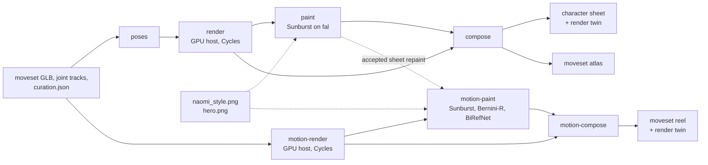

# Artwork: character sheet, moveset atlas, moveset in motion

This document covers the `r3d artwork` stages. They take the game-ready character and her retargeted moveset and draw them up in the client's art style as three deliverables: (1) a **character sheet** laid out like the client's reference sheet, (2) a **moveset atlas** with every captured clip at its contact frame, and (3) the **moveset in motion**, which is every clip as a video (a Cycles render plus a painted version where it passes a per-frame pose check) and a looping reel of all clips with their contacts in sync. Every figure is a render of the real character in a pose from her captured motion; the image and video models only repaint it, and a silhouette check decides whether a repaint is kept. A fourth part covers the render profiles: the same clips rendered for Meta Quest 3 (2064 x 2208 per eye, 60 fps, render only) or as a quick draft of that, each with a reel on the headset's canvas. The Naomi variant ([character.md](character.md#5-a-character-drawn-by-the-art-team-the-naomi-variant)) is delivered this way. The sections below give the design, the constants that decide what is accepted, the numbers from the current run (`runs/rybakina`) and the known limitations. The character itself is described in [character.md](character.md), capture and retargeting in [motion-pipeline.md](motion-pipeline.md), and the run folder, the GPU host and caching in general in [architecture.md](architecture.md). In this document, code paths are relative to `src/rybakina3d/` and output paths to the run folder `runs/rybakina/`.

## Deliverables

| Deliverable | File (under `runs/rybakina/artwork/`) | Format |
|---|---|---|
| Character sheet, painted | `rybakina_character_sheet.png` (+ `_preview.jpg`) | 3840 x 2560 PNG; the preview is a 1600 px JPEG |
| Character sheet, render only | `rybakina_character_sheet_render.png` (+ `_preview.jpg`) | the same layout from the unpainted renders, to show what is 3D |
| Moveset atlas | `rybakina_moveset_atlas.png` (+ `_preview.jpg`) | 3840 x 2560 PNG, 39 clips at contact |
| Moveset reel, painted where accepted | `motion/rybakina_moveset_reel.mp4` (+ `.jpg` poster) | 1920 x 2114 H.264, 25 fps, 5.2 s loop |
| Moveset reel, render only | `motion/rybakina_moveset_reel_render.mp4` (+ `.jpg`) | the same reel with every tile the render |
| Per-clip videos | `motion/render/<clip>.mp4`, `motion/painted/<clip>.mp4` | 1024 x 1024 H.264, 25 fps, one per clip |
| Turntable | `motion/render/turntable.mp4` | 1024 x 1024, 6 s, one full turn of the idle pose |
| Quest 3 clip videos | `motion/render_quest3/<clip>.mp4` (+ `.jpg` poster) | 2064 x 2208 H.264 High, level 5.2, 60 fps, CRF 16, render only |
| Quest 3 reel | `motion/<stem>_moveset_reel_quest3.mp4` (+ `.jpg`) | 2064 x 2208 H.264 High, level 5.2, 60 fps, a loop with all contacts aligned |
| Draft clip videos and reel | `motion/render_draft/<clip>.mp4`, `motion/<stem>_moveset_reel_draft.mp4` | 516 x 552 clips at 60 fps; the reel on the same 2064 x 2208 canvas |

`<stem>` is `rybakina`, or the variant's name for a character variant, whose files sit under `runs/rybakina/variants/<name>/artwork/` instead (`RunLayout.out`, see [architecture.md](architecture.md#character-variants-root-and-out)). The Rybakina files above use `rybakina_` directly.

## Running

```bash
.venv/bin/r3d artwork poses                  # workstation (pure numpy; runs anywhere)
.venv/bin/r3d remote artwork render          # GPU host: Blender + Cycles
.venv/bin/r3d artwork paint                  # workstation: GPT Image 2.5 Sunburst on fal
.venv/bin/r3d artwork compose                # workstation
.venv/bin/r3d remote artwork motion-render   # GPU host: Blender + Cycles, ffmpeg
.venv/bin/r3d artwork motion-paint           # workstation: Sunburst + Bernini-R + BiRefNet on fal
.venv/bin/r3d artwork motion-compose         # workstation: ffmpeg
.venv/bin/r3d site                           # rebuild the review site

# render profiles (section 4): the Quest 3 set, render only
.venv/bin/r3d remote artwork motion-render --profile quest3   # GPU host: 2064 x 2208 clip videos at 60 fps
.venv/bin/r3d artwork motion-compose --profile quest3         # workstation: the reel on the 2064 x 2208 canvas
```

`scripts/run_pipeline.sh` runs the first seven, in this order, as its `artwork` stage, all at the default `web` profile. `render`, `paint`, `motion-render` and `motion-paint` take `--force` to redo work their caches would otherwise skip; `poses`, `compose` and `motion-compose` rewrite their outputs every time. `motion-render` takes `--clip <id>` (repeatable) to limit what it renders, and `--profile` (`web`, the default, `quest3` or `draft`); `motion-compose` takes `--profile`. A variant runs with its own config; see [Running it for a variant](#running-it-for-a-variant).

Prerequisites (machine setup and secrets are in [setup.md](setup.md)):

- From `retarget`: `anim/rybakina_moveset.glb`, `anim/retarget.json` (bone mapping) and `anim/joints/<clip>.npz` (the character's joint tracks). From `curate`: `curation.json`.
- `character/sheet/hero.png` from [`character stylize`](character.md#2-stylize-r3d-character-stylize). It is the identity reference for every repaint.
- `naomi_style.png` at the project root. This is the client's style reference sheet: a character sheet of a different athlete in the target style. It is not in the repository (gitignored). The layout copies its arrangement, `paint` crops style references from it, and `compose` and `motion-render` sample its paper colour. `scripts/sync.sh` copies it to the GPU host for that reason.
- `FAL_KEY` (or `FAL_API`) in `.env` for `paint` and `motion-paint`. The key never leaves the workstation: `r3d remote` only runs the Blender steps on the host, and a pull from the host never overwrites artwork files made on the workstation (`WORKSTATION_ARTWORK` in `remote.py`). The motion PNG frames stay on the host (`artwork/motion/frames/`); only the videos are pulled.



## The shared studio look

The stills (`blender/artwork.py`, class `Studio`) and the videos (`blender/artwork_motion.py`, which subclasses it) use one Cycles setup:

- **Lights follow the camera**, as on a studio turntable. Each light sits at a fixed azimuth and elevation relative to the camera, 6 m from the target (`LIGHT_DISTANCE_M`):

  | Light | Azimuth / elevation (deg) | Size (m) | Power (W) | Colour | Shadow | Lights |
  |---|---|---|---|---|---|---|
  | key | 45 / 38 | 3.0 | 1100 | warm (1.0, 0.89, 0.76) | yes | the figure |
  | fill | -65 / 10 | 4.0 | 300 | cool (0.86, 0.92, 1.0) | no | the figure |
  | rim | -150 / 35 | 1.5 | 800 | warm white | no | the figure |
  | floor | 30 / 72 | 5.0 | 300 | warm white | yes | the floor only |

  The key sits low enough to light her eyes under the visor brim. Light linking splits the rig: the figure lights reach only her and the racket, and the separate high, soft floor light reaches only the shadow catcher. The contact shadow therefore stays short and under her, whatever the key does.
- **Shadow catcher.** A large floor plane is a Cycles shadow catcher on a transparent film, so the output is RGBA with only her soft contact shadow on it. For stills the floor sits at her lowest vertex when that is within `GROUNDED_M = 0.10` m of z = 0; otherwise she is in the air and the floor stays at z = 0, which leaves the shadow on the court.
- **Render settings.** World: a warm, paper-coloured ambient (0.93, 0.89, 0.83) at strength 0.3. Adaptive sampling, 8 bounces, OpenImageDenoise, AgX view transform with the "Medium High Contrast" look at exposure -0.75. The GPU backend is chosen in the order OptiX, CUDA, Metal, HIP, oneAPI, else the CPU.
- **Facing and camera.** Her facing in a frame is the direction her chest faces: the left-to-right shoulder line weighted `CHEST_WEIGHT = 3` to 1 against the hip line. From the hips alone a serve's trophy position would be seen from behind; the hip term steadies the estimate when a stroke coils the shoulders far past the hips. Cameras are placed by azimuth relative to that facing (0 = in front, 90 = her left side, 180 = behind) at `DISTANCE_PER_SIZE = 3.8` times the figure's size, which gives a long-lens look of about 85 mm. The lens and shift are then solved so the figure fills the frame with fixed margins (`MARGINS`).
- **What counts as her.** After the GLB import, the figure is every mesh that is skinned (an armature modifier) or parented to the armature or one of its bones, directly or through other objects (`moves_with`): a rigid visor or hair piece on the head bone moves with her. The racket is kept on its own. Every other mesh (the importer's bone-shape icosphere) is deleted, and so is any light the character GLB carries, so only the lights above light her.
- **Matte pass.** Every image is also rendered with Workbench as a flat dark figure (`MATTE_RGB`) whose alpha is her coverage without the shadow. The mattes drive the silhouettes on the sheet and every pose check.
- **Paper.** The paper colour is sampled from `naomi_style.png` as the most common bright, low-chroma colour (`paint.paper_colour`). In this run it is RGB (251, 246, 240).

## 1. Character sheet

### Layout

Code: `artwork/layout.py`.

The sheet is 3840 x 2560 (`SHEET_SIZE`, 3:2). Its slots copy the arrangement of the client's reference. Boxes are normalised `(x0, y0, x1, y1)` coordinates.

| Slot | Pose spec | Camera (azimuth, elevation, framing) | Painted |
|---|---|---|---|
| `front`, `back` | idle | 0 and 180, 5, full | yes |
| `hero` | backhand, contact - 8 frames (0.3 s before contact: the lunge with both hands on the racket, face up) | -35, 8, full | yes |
| `portrait` | idle | 55, 2, bust | yes |
| `action_a` ("Details") | forehand, contact - 2 | 45, 5, full | yes |
| `action_b` ("Details") | serve, trophy position | 70, 5, full | yes |
| `sil_1` ... `sil_6` | serve contact; forehand contact - 6; backhand contact + 8; forehand start; forehand contact + 6; serve contact + 10 | 40 to 80 or -60 (near side-on, so limbs and racket stay apart in a flat shape), 5, full | no, flat charcoal |
| `face_1` ... `face_4` | idle | -25, 0, 30, 60; elevation 0; head | yes |

The sheet also has a white title card (`CARD_BOX`; name plus the three rows in `layout.CARD`) and the script labels "Silhouettes", "Strokes" and "Details" (`LABELS`). "Idle" is the rig's rest pose with the arms brought down beside the body: 11° out, 4° forward, elbows bent 14° (`IDLE_*` in `blender/artwork.py`). Idle figures have no racket.

### Poses

Code: `artwork/poses.py`. Output: `artwork/poses.json`.

Poses are read from the character's own retargeted joint tracks (`anim/joints/<clip>.npz`, Z-up metres), which is what the render shows. They are not read from the SMPL motion.

- **Moments.** `contact` is curation's `contact_index`. `start` is frame 0. `trophy` is the serve's trophy position: the toss hand (the left wrist for a right-hander) at its highest within `TROPHY_WINDOW_S = 2.0` s before contact. The hand hangs there for about ten frames while the racket arm cocks, so the stage takes the last frame within `TROPHY_APEX_M = 0.05` m of the apex. Offsets are in frames and are clamped to the clip.
- **Which clip.** The candidates are the label-valid clips of that stroke (curation `label_ok`); if there is none, flagged clips are used and a warning is logged. They are ranked:
  1. Clips whose motion reads as the stroke at contact (`reads_as`). Broadcast labels swap forehand and backhand often enough to matter on a sheet. A two-handed backhand needs the wrists closer than `TWO_HANDED_GAP_M = 0.3` m at contact (both hands on the racket); a forehand needs them at least that far apart (the off hand has let go).
  2. Clips not yet on the sheet.
  3. QA PASS before WARN before FAIL.
  4. Curation score.
- **The hero** is ranked differently, to get the most dynamic readable stroke with her face visible:
  1. Clips that read as the stroke.
  2. Moments where her face shows: the neck-to-head line leans at most `HERO_MAX_HEAD_TILT_DEG = 35` from vertical. Beyond that she is bowed over the ball and the visor brim hides her eyes.
  3. QA not FAIL.
  4. Clips not yet on the sheet.
  5. The highest `dynamism`: the mean of hand speed / 5 m/s, hand reach in front of the chest / 0.4 m, stance width / 0.7 m and how low she sits / 0.15 m (`DYNAMISM_REF`).
- Slots are resolved biggest box first, so the big figures get the best clips. Two figures taken from one clip must be at least `MIN_MOMENT_GAP = 10` frames apart.
- **Atlas entries**: every moveset clip at its contact frame, in curation order, with the atlas camera.

What this run resolved (`poses.json`). All nine stroke slots got label-valid clips that read as their stroke.

| Slot | Clip | Frame | Moment | QA |
|---|---|---|---|---|
| hero | `backhand_14m19s` | 22 | contact - 8 (dynamism 1.149, head tilt 21.9°, 9 candidates) | PASS |
| action_a | `forehand_27m36s` | 25 | contact - 2 | PASS |
| action_b | `serve_16m13s` | 66 | trophy | WARN |
| sil_1 | `serve_10m12s` | 54 | contact | WARN |
| sil_2 | `forehand_09m57s` | 39 | contact - 6 | PASS |
| sil_3 | `backhand_00m12s` | 45 | contact + 8 | WARN |
| sil_4 | `forehand_12m58s` | 0 | start | PASS |
| sil_5 | `forehand_24m52s` | 36 | contact + 6 | WARN |
| sil_6 | `serve_08m29s` | 62 | contact + 10 | WARN |

### Render

Code: `artwork/render.py` (driver) and `blender/artwork.py` (runs inside Blender). Output: `artwork/renders/`.

The driver writes a JSON job and runs `blender/artwork.py` headless. The Blender binary is `$R3D_BLENDER`, else `remote.blender` from the config when it exists, else `blender`.

- Per figure: set the clip's action at the frame (or the idle pose), measure her facing, place the camera, then fit the frame to the framing:
  - `full`: every vertex including the racket, plus a 0.15 m ground patch around each foot (`GROUND_PATCH_M`) so the contact shadow fits.
  - `bust`: vertices above 0.20 m below the neck base (`BUST_DROP_M`).
  - `head`: vertices above 0.04 m below the neck base and within 0.16 m of the neck-to-head axis (`HEAD_DROP_M`, `HEAD_RADIUS_M`), which keeps hair and visor brim.
- Image heights (`HEIGHTS`): hero 2000 px, other full figures 1300, bust and head 1000, atlas 700. The width follows the pose. Cycles uses `SAMPLES = 128`.
- Each figure is written twice: `<name>.png` (Cycles, RGBA with the shadow) and `<name>_matte.png` (Workbench).
- `clean_shadow` runs after Blender on full figures. It drops shadow-catcher speckle below alpha `SPECKLE_ALPHA = 10` outside the figure and fades the shadow out over `BORDER_FADE = 10%` of the short side, so a figure composites without a hard edge.
- `renders.json` records per figure the files, size, matte bounding box, feet line, the floor point under her feet, the framed box, and the camera (azimuth, elevation, facing, distance, lens, shift, world matrix).
- Caching: a figure is re-rendered only when its spec (clip, frame, camera, height, racket), the GLB (size and mtime) or `RENDER_VERSION` (2) changes, or with `--force`. Figures no longer on the sheet are deleted.

This run used Blender 5.2.2 LTS with OptiX on one NVIDIA A100 40 GB. The 16 slot figures took 50.8 s of Cycles time in total (median 2.3 s; the 2280 x 2000 hero 13.7 s). The 39 atlas figures took 61.0 s (median 1.6 s). Each slot matte took 0.1 to 0.9 s, each atlas matte at most 0.1 s.

### Paint

Code: `artwork/paint.py`. Output: `artwork/painted/`.

Each paintable slot (front, back, hero, portrait, the two action figures and the four heads) is repainted by `models.image_paint` = `openai/gpt-image-2.5/sunburst/edit` on fal. Silhouettes and the atlas are not painted.

**Request.** Three images and a prompt:

1. The render composited over the paper colour: the POSE AND COMPOSITION source. Before compositing, the render is cleaned to the figure plus its contact shadow (`render_rgba`), because Cycles leaves faint alpha blotches on the transparent film.
2. A crop of the same kind of figure from `naomi_style.png`: the STYLE reference (`STYLE_CROPS`, one per kind: `standing`, `hero`, `portrait`, `action`, `head`).
3. `character/sheet/hero.png`: the IDENTITY AND OUTFIT reference.

The prompt (`paint.prompt`) asks the model to keep the pose, proportions, camera, framing and racket of image 1 exactly; to copy only the painting style of image 2 (a different person); to take face, hair and outfit from image 3; and to paint over the 3D model's texture glitches (skin-coloured patches on the dress, seams across the face, stringy hair) without changing any outline. Two notes may be added:

- A per-kind note (`KIND_NOTES`), for example that a back view must show her back, or that a portrait or head must keep its crop.
- A grip note (`GRIP`) on racket poses. Rybakina's rig has no finger bones, so the rendered hands are stiff and open. The note asks for the fingers wrapped around the grip, and on the two-handed backhand for both hands on the handle. This changes the figure only inside its silhouette. Naomi's moveset (`configs/naomi.yaml`) adds 30 finger bones and IKs the left hand onto the handle ([character.md](character.md#4-the-racket)), so its renders show closed hands already.

**Output and size.** The output is the figure alone on a transparent background (`BACKGROUND = "transparent"`). On the hero slot, the transparent and the paper-coloured variants kept the pose about equally well (aligned IoU 0.94 and 0.92). Only the transparent variant gives a clean cut-out, because on paper the white visor, dress and shoes barely separate from the background. Request sizes are the render size scaled into 1.1 to 4 megapixels (`MIN_PIXELS`, `MAX_PIXELS`), at most 3840 px on an edge, in multiples of 16, so the small head renders are sent upscaled. Quality is `xhigh` for the hero and the portrait and `high` otherwise. Four slots are painted in parallel (`WORKERS = 4`).

**Silhouette check.** The pose is her captured motion, so a repaint is accepted only if its silhouette matches the render's matte:

- `painted_mask` takes the repaint's alpha (or, for an opaque result, its distance from the border colour). `clean_mask` opens and closes it, keeps the components larger than 2% of the biggest one and fills enclosed holes (the racket head, the gap between joined hands).
- `aligned_iou` maps the repaint's bounding box onto the render's before computing IoU, so drift in position and scale does not count; shape does.
- Accepted when `IoU >= ACCEPT_IOU = 0.85`.

**Retries and fallback.**

- A miss is retried once with a stricter prompt (`STRICT`: trace image 1's outline exactly) and `RETRY_CANDIDATES = 3` samples. The best of all samples (at most 4) counts.
- If the best is still below 0.85, the slot falls back to the render.
- fal's output moderation rejects the odd sample of a figure in a short dress lunging (`content_policy_violation`). In this stage a moderated attempt is recorded and the stage moves on to the next attempt, so a moderated first attempt goes to the strict retry. If every attempt is moderated, the slot records an error and keeps the render.

**Cut-out.** `artwork/painted/<slot>_cut.png` is what `compose` lays out:

- `similarity` scales the repaint uniformly by height and sets it on the render's feet line, centred on it. Busts and heads are cut by the frame, which already fixes their placement, so they keep it.
- The figure is warped in premultiplied alpha and laid over the render's own ground shadow (`_shadow_layer`). Under the figure, the shadow is continued from the nearest pixel outside it, so a repainted foot that sits slightly higher or is smaller than the rendered one still stands in its shadow, and a slimmer repaint shows no ghost of the rendered body.
- Raising `CUT_VERSION` (now 4) re-cuts the accepted repaints without calling the model.

**Cache.** The key (`fingerprint`) is the render and matte bytes, the model and the slot's own prompt text. Editing one kind's prompt repaints only that kind. `compose` refuses a repaint whose fingerprint no longer matches the current render and uses the render instead.

Files in `artwork/painted/`: `<slot>.png` (accepted repaint as returned), `<slot>_cut.png`, `<slot>.json` (the record: accepted, IoU, every attempt, model, kind, grip, fingerprint), `attempts/` (every sample), `inputs/` (the exact images sent) and `paint.json` (all slots).

Results in this run: all 10 paintable slots were accepted.

| Slot | Kind | Request size | Quality | Samples | IoU |
|---|---|---|---|---|---|
| front | standing | 688 x 1568 | high | 1 | 0.902 |
| back | standing | 672 x 1600 | high | 1 | 0.876 |
| hero | hero, two-handed grip | 2128 x 1872 | xhigh | 4 (0.820, then strict 0.947 / 0.933 / 0.872) | 0.947 |
| portrait | portrait | 896 x 1200 | xhigh | 1 | 0.956 |
| action_a | action, racket grip | 1136 x 1296 | high | 1 | 0.874 |
| action_b | action, racket grip | 752 x 1440 | high | 1 | 0.852 |
| face_1 ... face_4 | head | about 1000 x 1100 | high | 1 each | 0.978, 0.912, 0.941, 0.934 |

One call took 33 to 66 s.

### Compose

Code: `artwork/compose.py`. Output: the two sheets, the atlas and `artwork/artwork.json`.

- **Paper.** The sampled paper colour, a little brighter in the middle, a soft warm vignette towards the corners, faint smooth mottling and fibre grain. A final light grain goes over everything so painted figures and paper read as one print.
- **Figures.** Each slot uses its painted cut-out if `paint` accepted it and its fingerprint is current, otherwise the cleaned render.
  - Whole figures stand on their box's feet line, with `GROUND_MARGIN = 3.5%` of the box left for the shadow.
  - The front/back pair shares one physical scale (the smaller fit), and the six silhouettes share one (their median fit). Pixels per metre come from each render's camera (lens and distance), so the shared scale is physical even though each render is framed on its own.
  - The 3/4 bust dissolves into the paper over the lower part of its box along a wavering line.
  - Heads sit on light rounded tiles with a soft shadow.
  - Silhouettes are flat charcoal shapes made from the mattes, over a lightened copy of the render's shadow.
- **Type.** The title card uses a serif face. The section labels use a script face with thin rules. A two-line provenance note sits bottom left ("Painted over 3D renders of the game-ready character / every pose from her captured motion"; the render twin says "Unpainted"). Fonts are macOS system fonts (Baskerville, Didot, Snell Roundhand, Savoye LET, Apple Chancery) with DejaVu fallbacks on Linux, else PIL's default font.
- **Outputs.** The painted sheet, the render-only twin (same layout, every figure the render) and the atlas (below), each with a 1600 px JPEG preview (quality 88). `artwork.json` records the inputs, which source each slot used (painted, render, silhouette, missing), the scales and the paint results. In this run: 10 painted, 0 render, 6 silhouettes, 0 missing. The sheet is 10.2 MB, the render twin 9.8 MB and the atlas 9.8 MB.

## 2. Moveset atlas

`rybakina_moveset_atlas.png` is a second 3840 x 2560 sheet with every moveset clip (39) at its contact frame. All figures use one camera (`layout.ATLAS`: azimuth 30, elevation 8, full framing) and are 700 px renders.

- **Grouping.** Clips are grouped by stroke in the order serve, forehand, backhand, slice, overhead, and in curation order within a group. Each group starts a new row of the 12-column grid unless it fits whole into what is left of the current row, one empty column after the previous group (`compose.atlas_grid`). Here that gives 12 serves, 12 forehands and 12 backhands on one row each, then slice (1) and overhead (2) sharing the last row.
- **One physical scale.** The common pixels-per-metre is the 10th percentile of what each cell allows. A figure that would overflow its cell at that scale is shrunk on its own.
- **Captions and key.** Each figure is captioned with its clip id, which is the clip's time in the source video. Clips that `curate` flagged against their stroke label (15 of 39) get a small mark. A key explains the mark and shows a one-metre bar at the common scale.
- The atlas is not painted.

## 3. In motion

### motion-render

Code: `artwork/motion_render.py` (driver) and `blender/artwork_motion.py` (runs inside Blender). Output: `artwork/motion/render/`.

Each moveset clip (flagged ones too, in curation order) is rendered as a video of the character, plus a turntable of the idle pose.

- **One fixed camera per clip** at the atlas angle (`layout.MOTION`: azimuth 30, elevation 8, relative to her facing at contact). It is aimed at and fitted to the union of every frame's vertices, racket included, plus the ground patch around her feet. She moves through a still frame and never leaves it. The lights stay fixed to that camera.
- **Real time.** Frame i of the video is frame i of the clip at 25 fps, the source footage's rate.
- **Floor.** The floor follows her lowest vertex while she is on the ground (within `GROUNDED_M`, the stills' rule) and is interpolated across the frames she is in the air (`floor_track`). Her feet stay on their shadow, a contact frame matches its atlas still, and a jump leaves the shadow on the court. The highest she gets off the floor in this run is 0.39 m.
- **No frame-to-frame noise.** Cycles uses a fixed noise seed (`use_animated_seed = False`) and persistent data, so only she changes between frames and the floor does not shimmer.
- **Opaque paper.** Video models do not take alpha, so each frame is composited over flat paper colour, without the sheet's vignette or grain (they would flicker). The figure is kept as rendered, plus its rim. Outside it, only the contact shadow prints: alpha above `paint.SHADOW_FLOOR = 0.05`, inside the floor region her shadow can reach (`SHADOW_REACH_M = 0.9` m around her feet), faded over `EDGE_FADE_PX = 24` px.
- **Matte video.** `<clip>_matte.mp4` carries the Workbench matte as luminance (255 = figure, no shadow). Its anti-aliasing uses 8 samples (`MATTE_AA`); the stills use 16.
- **Turntable.** The idle pose without the racket, seen by a camera orbiting her once in `MOTION.turntable_s = 6` s (150 frames, a closed loop). The lights orbit with the camera.
- **Encoding.** libx264, yuv420p, BT.709 limited range, preset `slow`, `+faststart`. CRF 18 for the video and 12 for the matte. Each clip has a JPEG poster at its contact frame. Encoding runs in two worker threads while Blender renders the next clip.
- **Samples.** `layout.MOTION.samples` is 64, but `motion_render.SAMPLES` is web's `layout.PROFILES` entry, `min(MOTION.samples, 48)` = 48. A code comment there records the reason: at 64 samples the 2681 frames take about 65 minutes on the A100, and at 48 the run fits in an hour, with OIDN output differing from 64 samples by 0.7/255 on average.
- **Checks** recorded per clip: empty frames, frames where the figure touches the image border, and shadow flicker (mean change on the floor between consecutive frames, away from the figure).
- **Cache.** A video is skipped while its fingerprint matches and its files exist. The fingerprint covers the GLB's SHA-1, `MOTION_VERSION`, the camera, size and samples, the clip and its contact, the paper and the encoding settings. Frames already rendered under the same render key (the fingerprint without the paper and the encoding, see [section 4](#fingerprints-render-keys-and-kept-frames)) are only re-encoded. `--force` renders everything again. `backhand_14m19s` and `serve_16m13s` are rendered first (`FIRST`), so problems show early.

Numbers from this run (`artwork/motion/render/renders.json`):

| | Value |
|---|---|
| Videos | 39 clips + turntable, 1024 x 1024, 25 fps, 48 samples, Blender 5.2.2 LTS, OptiX on one A100 40 GB |
| Frames | 2531 clip frames (58 per forehand, backhand, slice or overhead; 75 to 81 per serve) + 150 turntable frames |
| Cycles time | 2985 s for the clips (1.18 s per frame) + 132 s for the turntable; clip mattes 356 s; whole run 3554 s (about 59 minutes) |
| Size | 12.9 MB of clip videos, 11.9 MB of mattes |
| Checks | no empty frames, no frame touching the border; worst shadow flicker 3.4 grey levels (median per clip 1.7) |
| Scale | 199 to 474 px per metre at the camera target, depending on how far each clip's motion spreads |

### motion-paint

Code: `artwork/motion_paint.py`. Output: `artwork/motion/painted/`.

Each clip's render is repainted into the sheet's look in four steps.

**1. Anchor.** Frame 0 is repainted like a sheet figure, through the same functions as `paint`:

- Model `models.image_paint` (Sunburst). Inputs: the frame, the reference's `action` style crop and `hero.png`. Prompt: `paint.prompt` for an action figure plus the stroke's grip note. Transparent background, quality `high`.
- Accepted at aligned silhouette IoU `>= ANCHOR_IOU = 0.80` against the matte, with one strict best-of-3 retry. The code explains why this is below the sheet's 0.85: the anchor only sets the look, and the motion is judged frame by frame afterwards. Side-on serve stances scored 0.82 to 0.84 with the pose right (a fuller painted body, a thin racket).
- A call rejected by the provider's moderation is repeated, up to `MODERATION_TRIES = 3` calls. This applies to every fal call in this stage (anchor, video, matting).
- The accepted cut-out is set on the render's feet line (`paint.similarity`) over the frame's own paper and shadow with the rendered figure taken out (`plate`). This is `artwork/motion/painted/first/<clip>.png`.
- If no sample passes, the clip keeps its render. An anchor rejected under an earlier, stricter bar that now passes is re-cut from its saved sample without a new call.

**2. Video.** `fal-ai/bernini-r/reference-edit-video` (`models.video_paint`, `VIDEO_MODEL`) re-renders the render clip. Its reference images are, in order: the anchor, the style crop, the hero and, when one was accepted on the sheet, a sheet repaint (`action_a`, else `action_b`, else `hero`). The prompt says to carry the anchor's painted look through every frame and to keep the motion, timing, racket, camera and framing exactly. The images steer the look; nothing pins frame 0 to the anchor.

- **Frame-count rule.** Bernini-R takes 4k + 1 frames, from 5 to 121 (`VIDEO_MIN_FRAMES`, `VIDEO_MAX_FRAMES`). Given another count it would snap the count itself and lose the frame alignment. `plan` therefore holds frame 0 at the head of the clip up to the next 4k + 1: the 58-frame groundstrokes go as 61 frames (3 held), the 81-frame serves as they are, and the 75-frame serve as 77. Clips longer than 121 frames (4.84 s) are refused with an error.
- **Request.** 25 fps, `max_image_size = 1024`, `num_inference_steps = 40` (the model's default is 30), prompt expansion off. The clip is sent at CRF 10 (`SEND_CRF`), visually lossless.
- **Mapping back.** `frame_map` maps the output so that painted frame i shows render frame i, by time at the output's frame rate. If the output's duration is more than 5% off the sent duration, it is treated as stretched over the whole clip. The output is resized to the render's size.

**3. Pose check, per frame.**

- A white dress on off-white paper defeats a colour key, so every output frame is matted with BiRefNet video (`fal-ai/birefnet/v2/video`, "General Use (Light)", 1024 x 1024).
- Each mask is compared with the render's matte using `paint.aligned_iou`.
- As a control, the same matting is run on the render itself and compared with its matte. It scored a median of 0.98 on a test forehand, which shows how much of a miss is the matting's own error.

A clip is accepted when all of the following hold (`judge`):

| Check | Constant | Threshold |
|---|---|---|
| The model's frame 0 has the anchor's silhouette (same canvas, unaligned IoU) | `FIRST_MATCH_IOU` | >= 0.85 |
| Per-frame aligned IoU, median over the clip | `ACCEPT_MEDIAN` | >= 0.85 |
| Per-frame aligned IoU, 10th percentile (a few frames may dip: fast racket, motion blur) | `ACCEPT_P10` | >= 0.75 |
| Racket recall, median: share of the render's racket pixels with red paint within 3 px | `RACKET_MEDIAN` | >= 0.7 |
| Racket recall, 10th percentile (a racket that is gone at contact fails here) | `RACKET_P10` | >= 0.5 |

The racket gate exists because a racket dissolving into the swing barely moves the silhouette. The rendered racket frame is the only saturated red in a render (OpenCV hue <= 10 or >= 165, saturation >= 140; skin stays below that; the painted frame counts red from saturation 70). Frames with fewer than `RACKET_MIN_PX = 60` racket pixels (racket edge-on or behind her) are skipped. These are recorded but not gated: how much of the anchor's look survives (`look_carried`), flicker (temporal second difference, painted vs render) and colour drift from frame 0 (CIELAB ΔE, painted vs render).

**4. Composite.** An accepted clip is the painted figure, cut out by BiRefNet's soft matte (only near its cleaned mask, so no specks), over the render's own paper and contact shadow (`BACKGROUND = "render"`). Every clip therefore sits on the same clean paper whatever the model did to the background. Output is CRF 14. A clip that fails any check, or whose call fails, keeps its render. A failed call is retried on the next run, and its anchor is kept.

Operational details:

- Eight clips are in flight at once (`WORKERS = 8`). A code comment puts a Bernini-R call at about ten minutes per clip.
- If fal answers that the endpoint's API access is unavailable (`CLOSED`), the stage stops starting new clips.
- The stage refuses any `models.video_paint` other than Bernini-R (`check_model`), because the request is written for that model.
- The cache key covers the render and matte bytes, both models, the request (prompt included), the matting model and `BACKGROUND`. A changed render or prompt repaints that clip, and `--force` repaints all. Changed thresholds are re-applied to cached clips without a call; `reassess` re-runs the checks on a saved output.
- Cost: the report uses `VIDEO_PRICE_USD_S = 0.08` USD per output second (the fal list price recorded in the code). At that rate the 39 clips are 104.6 s of sent video, about USD 8.4 for the video calls. The anchor and matting calls are not counted.

Files per clip, in `artwork/motion/painted/`:

- `<clip>.mp4`: the accepted painted clip.
- `<clip>.json`: the record. It holds the request, sent and output timing, the frame map, IoU per frame with median / p10 / min, the control, first-frame match and look, racket, flicker, drift, accepted and why, cost, latency and fingerprint. `paint.json` has all clips without the per-frame lists.
- `first/`: the anchors and their attempts.
- `attempts/<clip>.raw.mp4`: the model's output as downloaded, together with the mapped video, the masks (`.masks.npz`) and the soft matte (`.alpha.mp4`).
- `sent/`: exactly what the model received.

**Why Bernini-R.** During development, several fal video models were tried on one test forehand with the per-frame silhouette measure above. The `motion_paint.py` docstring records that Bernini-R's reference video edit kept the motion best: per-frame IoU median 0.96, 10th percentile 0.90, racket recall 1.0. The smoke-test outputs are not part of the run folder. Kling v4 video edit, the endpoint used before, was closed to API callers on 2026-10-22 (comment on `models.video_paint` in `configs/rybakina.yaml`).

**Status at the time of writing (snapshot at about 03:00 on 2026-10-22).** The full motion-paint run was still in progress, started under the earlier anchor bar of 0.85 (`paint.json` records `first_repaint: 0.85`). 17 of the 39 clips had a frame-0 anchor: 13 accepted at aligned IoU 0.853 to 0.916, 4 rejected at 0.666, 0.826, 0.837 and 0.840. Under the current `ANCHOR_IOU = 0.80`, the last three pass on the next run without a new image call (`_first_frame` re-cuts the saved sample), and their videos are made then. 5 clips had come back from Bernini-R and been judged, and 1 was accepted: `serve_14m50s`, per-frame IoU median 0.95, 10th percentile 0.92, racket recall 1.0. Of the 4 rejected, `serve_27m33s` and `serve_05m21s` held the silhouette on most frames (median 0.94 and 0.91) but dropped to a 10th percentile of 0.03 and 0.07; on `serve_13m32s` and `serve_16m13s` the model's frame 0 already left the anchor (0.64 and 0.73 against `FIRST_MATCH_IOU = 0.85`) and the whole clip missed (median 0.11 and 0.14). The video calls so far cost USD 1.29 at list price. *Maintainer: replace this paragraph with the final counts from `artwork/motion/painted/paint.json` (`accepted`, `n`, `cost_usd`) and the IoU range of the accepted clips.*

### motion-compose

Code: `artwork/motion_compose.py`. Output: the two reels, the site copies and `artwork/motion/motion.json`.

The reel is the atlas set in motion: every clip's video in a grid of `MOTION.reel_columns = 8` columns, with the strokes in the atlas's order and rows, on the sheet's paper, with the atlas's script group labels, clip-id captions and curate-flag marks.

- **Contacts in sync.** Each tile is shifted in time so that every contact falls on one reel frame, the latest contact of any clip (frame 75 = 3.0 s here, so no clip starts before frame 0). A clip holds its first frame until its swing has to start and its last frame once it is done.
- **Padding and loop fade.** After the last clip ends, every tile rests on its last frame for `HOLD_S = 0.24` s (6 frames). Over `TAIL_S = 0.48` s (12 frames) each figure then fades from its finish into the paper and back in at its first frame, so two poses never show ghosted together and the reel loops without a cut. The encoder puts one keyframe per loop, so the static paper does not pulse.
- **Tiles.** Each tile video is decoded once (at the site-copy size, then scaled down to the tile). It is laid on the reel's paper multiplicatively against its own paper colour (the median of its top, left and right border bands, smoothed over 5 frames). Its paper thus becomes the reel's paper (no tile edges, and a painted tile's drifting paper tone is evened out), while the figure and shadow stay as rendered. Tile edges are feathered over 3.5% (`FEATHER`).
- **Timeline.** A hairline in the title carries a tick at the contact instant and a dot moving along it.
- **Painted where accepted.** In `rybakina_moveset_reel.mp4`, a tile is the painted video where `artwork/motion/painted/<clip>.json` says accepted and the file exists, otherwise the render. When the reel mixes the two, a small ring after the caption marks the render tiles, and the key explains it. Painted frames are resampled to the render's frame count if the counts differ. While no clip is accepted, the painted reel is a copy of the render reel.
- **Render twin.** `rybakina_moveset_reel_render.mp4` uses the render for every tile.
- **Grid copies for the site.** `artwork/motion/rybakina_moveset_tiles/<clip>.mp4` and `<clip>_painted.mp4` are light 360 px copies (CRF 23) with a contact-frame JPEG each, because dozens of 1024 px videos playing at once would choke a browser.
- Real time at 25 fps, H.264 yuv420p with faststart, 1920 px wide, CRF 20. `motion.json` records which tiles are painted, the layout, the timing and the sizes.

In this run the reel is 1920 x 2114 with 216 px tiles in 7 rows and 130 frames (5.2 s), contact at 3.0 s. Each reel file is 2.0 MB. At the time of writing every tile is the render (see the status above).

## 4. Render profiles: the Quest 3 set

Code: `artwork/layout.py` (`RenderProfile`, `PROFILES`), `artwork/motion_render.py`, `blender/artwork_motion.py`, `artwork/motion_compose.py`.

`motion-render` and `motion-compose` take `--profile`. A profile sets only the frame size, the frame rate, the samples and the encoding. The camera rule (`layout.MOTION`'s angle relative to her facing at contact, fitted to the whole clip), the lights, the floor track, the paper composite and the checks are the same for every profile. `web` is the profile that section 3 describes.

| Profile | Frame (w x h) | fps | Samples | Encoding (libx264, yuv420p) | Matte video, turntable | PNG frames on the host | Output folder |
|---|---|---|---|---|---|---|---|
| `web` (default) | 1024 x 1024 | 25 | 48 | CRF 18, preset `slow`; matte CRF 12 | yes | kept, in `motion/frames/<clip>/` | `motion/render/` |
| `quest3` | 2064 x 2208 (one Meta Quest 3 eye, portrait) | 60 | 16 | CRF 16, preset `slow`, High profile, level 5.2, BT.709 tagged in the stream's VUI | no | deleted once encoded, from `motion/frames/quest3/<clip>/` | `motion/render_quest3/` |
| `draft` | 516 x 552 (`quest3` at 1/4 linear size) | 60 | 16 | CRF 18, preset `medium`, High profile, BT.709 tagged in the VUI | no | kept, in `motion/frames/draft/<clip>/` | `motion/render_draft/` |

The reasons, as recorded in `layout.py`:

- **60 fps.** The headset refreshes at 72, 90 or 120 Hz, where 25 fps judders.
- **16 samples.** A `quest3` pixel covers about 1/4.3 of a web pixel's share of the figure, so per unit of picture this is still about 1.4 times the web budget (16 x 4.3 against 48), and OIDN's leftover blotches are half the angular size. The fixed noise seed keeps the floor still, and each frame's noise shows for only 1/60 s. At 32 samples (the measurements below), `backhand_14m19s` showed no visible noise at 1:1. 16 samples halve the Cycles share, which matters on a GPU shared with other jobs (a run was 1.7 times slower while another process used it).
- **CRF 16 and level 5.2.** A headset magnifies, so the CRF is finer than web's 18. 2064 x 2208 at 60 fps is 1.07 M macroblocks a second, above level 5.1's 0.98 M.
- **BT.709 in the VUI.** Primaries, transfer and matrix are written through `-x264-params`, because ffmpeg's `-color_primaries` and `-color_trc` do not reach the stream through the scale filter. The web videos keep their command unchanged and carry only the matrix and range.
- **Render only.** `quest3` and `draft` write no matte video (nothing paints them) and no turntable.

### Time at 60 fps

The actions stay keyed at the clips' 25 fps. `frame_times` (`blender/artwork_motion.py`) maps each output frame to an action time:

- The duration is kept: a clip of n frames gives `round(n x 60 / 25)` output frames (58 → 139, 75 → 180, 81 → 194). The moveset's 2531 clip frames become 6065.
- Output frames are 25/60 of a clip frame apart, and the grid is phased so the contact lands exactly on output frame `round(contact x 60 / 25)`. The contact frame is therefore still the atlas pose, and the reel can line contacts up on one frame. Times are clamped to the clip (0 to n - 1), so the last pose is held for about its own 1/25 s, as at the source rate.
- Between keys, Blender interpolates the importer's linear keys. The 60 fps videos add no captured motion; they sample the 25 fps motion more finely.
- Each output frame is rendered as a still at its sub-frame, with the floor set for it. All Cycles frames of a clip go first, then all Workbench mattes, so the engines do not alternate per frame and persistent data is kept. At 25 fps (web) the clip is still one animation render, frame i = clip frame i.
- `renders.json` records per clip `source` (`fps`, `n_frames`, `contact_frame` at the clip rate) and, off the clip rate, every output frame's action time (`source.times`; `null` for web).

### Portrait framing

The camera is fitted to the profile's frame, square or not, with a vertical sensor fit: the lens is `24 mm x f_px / H` and the shift is in units of the image height. A portrait frame binds on width for a lunge and on height for a serve, and the other axis keeps the slack.

The composite's pixel constants were tuned at 1024 px. Distances (`EDGE_FADE_PX`, `NEAR_PX`, `FLOOR_CLEAR_PX`) scale by `RenderProfile.scale`, the square root of the frame's area over 1024 x 1024 (2.08 for `quest3`, 0.52 for `draft`). Alpha levels (`ALPHA_MIN`, `SHADOW_FLOOR`) are coverage and do not scale.

Cycles renders each frame as one tile (`tile_size` raised to the frame size). Past the default 2048 px, a 2064 x 2208 frame would render as a big tile plus thin strips; one tile measured 9 % faster.

### Fingerprints, render keys and kept frames

- **One profile, one folder.** A profile reads and writes only its own output folder, its own `renders.json` and its own frames (`motion/frames/` for web, `motion/frames/<profile>/` otherwise, each with its own `job.json` and `blender.log`). It never clears another profile's frames or videos.
- **Fingerprint.** A web video's fingerprint is the formula from before profiles existed, so the web videos stayed cached. Any other profile adds all its fields (except `keep_frames`), the clips' rate and `PROFILE_VERSION` (1).
- **`smooth_skin`.** `True` for `quest3` and `draft`: the studio welds coincident vertices of the figure, switches its armature to dual-quaternion skinning (`use_deform_preserve_volume`) and adds a Corrective Smooth (factor 0.5, 10 iterations, length-weighted, rest shape from the original coordinates) over the deformation (`blender/artwork.py` `_smooth_skin`). At the 2064 x 2208 close-up a bent knee otherwise pinched into folds behind the joint; modelled detail stays because only the deformation is smoothed. Web keeps the plain linear skinning its videos were made with.
- **Render key.** The fingerprint without the paper and the encoding. Blender writes it into each clip's `blender.json`. When only the encoding changes, frames still on the host under the same render key are re-encoded without Blender.
- **`keep_frames`.** `False` for `quest3`: each clip's PNGs (about 3.2 MB a frame, about 19 GB for the moveset) are deleted after its video is encoded, once the run's Blender job has finished, and `blender.json` stays as the record. A changed `quest3` encoding therefore renders again. A run over a few clips at a time (`--clip`, or `scripts/render_quest3.sh`) keeps the peak on the host's disk to those clips' frames. `keep_frames` changes no output and is in no fingerprint.
- **`--clip <id>`** (repeatable) limits what is made. The other clips keep their `renders.json` rows while their fingerprint matches.

### Measured

One A100 40 GB, OptiX, Blender 5.2.2 LTS. `backhand_14m19s` is Rybakina's (58 clip frames, 139 output frames, contact on output frame 72), from `artwork/motion/render_quest3/renders.json` and `render_draft/renders.json`. The `quest3` column was measured at 32 samples, before the profile was set to 16. That render's fingerprint no longer matches, so the next `quest3` run renders it again. The 16-sample times are Naomi's full set, after the table.

| | `quest3` (32 samples) | `draft` |
|---|---|---|
| `backhand_14m19s`, per frame | 4.2 s Cycles + 0.64 s matte | 0.41 s Cycles + 0.05 s matte |
| `backhand_14m19s`, files | 1.35 MB video for 2.3 s; 438.5 MB of PNG frames before deletion | 0.19 MB video; 33.7 MB of PNG frames, kept |
| `backhand_14m19s`, checks | no empty or border frames; shadow flicker at most 0.74 grey levels | the same; at most 0.69 |
| The moveset's 6065 frames at that rate | about 8.2 h | about 47 min |

Encoding runs beside Blender (69 s for the `quest3` backhand). Naomi's full draft on the earlier Hunyuan3D character (archived in `archive/naomi_hunyuan/artwork/motion/render_draft/renders.json`, 39 clips, 6065 frames) took 4240 s of Blender time (about 71 min): 0.53 s Cycles and 0.09 s matte a frame, plus about 12 s of setup per clip (posing and measuring every output frame to fit the camera), against 1.5 s for Rybakina's backhand; that moveset had 200,402 triangles (the current Hi3D one 280,416), Rybakina's 25,004. Its 39 draft videos are 9.7 MB together (0.12 to 0.39 MB each), with 1.6 GB of PNG frames; no empty or border frames; the worst shadow flicker is 2.4 grey levels (median per clip 1.2); 101 to 260 px per metre at the camera target.

Naomi's full `quest3` set on the Hi3D character (`variants/naomi/artwork/motion/render_quest3/renders.json`, 16 samples, 39 clips, 6065 frames, finished on 2026-10-23) took 23,076 s of Blender time (6.4 h): 2.56 s Cycles and 1.07 s matte a frame, plus 23 to 34 s of setup per clip. Encoding beside Blender took 3,094 s. `DETACH=1 scripts/render_quest3.sh` ran it on the host in 10 batches of 4 clips, 6 h 47 min from the first batch to the rebuilt site. The 39 videos are 76.4 MB together (0.92 to 3.01 MB each, median 2.03 MB), from 20.4 GB of PNG frames deleted batch by batch; no empty or border frames; the worst shadow flicker is 2.6 grey levels (median per clip 1.2); 407 to 1037 px per metre at the camera target. Single test clips earlier, with the GPU shared with another job, ran at roughly 2.3 to 4.8 s of Cycles a frame.

### The Quest 3 reel: `motion-compose --profile quest3`

`--profile quest3` (or `draft`) composes one render-only reel from that profile's renders (`motion/render_<profile>/renders.json` and the videos in that folder). It never reads `motion-paint`. The design is the web reel's: the atlas's stroke groups and order in 8 columns, every contact on one reel frame, the hold and the loop fade (at 60 fps, 14 and 29 frames), the paper, the group labels, the clip captions and flag marks, the key and the timeline.

- **Fixed canvas.** Every non-web reel is 2064 x 2208 (`REEL_EYE`, the `quest3` frame), the draft's too, at the renders' frame rate (60 fps). At that width the natural tile is 232 px, and 39 clips in 7 rows would need 2270 px. The tiles, and with them the group headers and captions, shrink in 2 px steps until the grid and its key fit: 224 px for the 39 clips. Nothing is cropped. Height left over stays paper under the grid; a smaller set can keep the 232 px tiles.
- **Contain-fit tiles.** The clips are portrait (2064 x 2208, or 516 x 552) and the tiles square. Each clip is fitted into its tile whole (`contain`) and padded with that frame's own paper colour, which the paper-ratio compositing turns into the reel's paper. The feather follows the picture's edges inside the tile. A serve's racket at the top of a portrait frame stays in.
- **Captions.** The title is `cfg.display_name` (`character.name`, else the athlete's) followed by "The Moveset in Motion". The two caption lines, in capitals, read "39 captured strokes · aligned on contact · real time, 60 fps" and "3D renders of the game-ready character". For a variant the first line says whose strokes it plays: "39 strokes captured from Elena Rybakina · …". There are no ring marks, because every tile is the render.
- **Partial results.** A clip without a render is left out with a warning, so the reel can be composed while `motion-render` is still working through the clips. A clip video at another frame rate than the reel's is logged as playing off real time, because each tile plays one source frame per reel frame.
- **Encoding.** H.264 High, level 5.2, CRF 16 (`CRF_EYE`), yuv420p, BT.709 matrix, primaries and transfer tagged, faststart, one keyframe per loop.
- **Site copies.** `<stem>_moveset_tiles_<profile>/<clip>.mp4` (+ `.jpg` at contact): 360 px on the long edge with the aspect kept (336 x 360), CRF 23, BT.709 tagged.

Files under `artwork/motion/`:

| File | Content |
|---|---|
| `<stem>_moveset_reel_<profile>.mp4`, `.jpg` | the reel and its poster at the contact instant |
| `<stem>_moveset_tiles_<profile>/<clip>.mp4`, `<clip>.jpg` | the review site's light copies |
| `motion_<profile>.json` | the report below; every path in it is relative to the run root |

| `motion_<profile>.json` key | Content |
|---|---|
| `profile`, `name` | the profile; the display name |
| `motion_from` | for a variant, the athlete whose captured strokes it plays; otherwise `null` |
| `size`, `fps` | the reel's canvas (2064 x 2208, for the draft too) and its frame rate |
| `reel` | `mp4`, `poster`, `frames`, `loop_s`, `mb` |
| `groups` | `[{stroke, clips: [ids]}]` in the reel's order |
| `clips` | one row per clip in the reel: `id`, `stroke`, `flagged`, `mp4` (the full-size render), `poster`, `tile`, `tile_poster`, `size` (the render's), `fps`, `frames`, `contact_frame`, `mb` |
| `made` | when the reel was composed |

Naomi's Quest 3 reel (`variants/naomi/artwork/motion/naomi_moveset_reel_quest3.mp4`, composed on 2026-10-23 after the last batch) holds all 39 clips in 7 rows of 224 px tiles: 2064 x 2208, 60 fps, 312 frames (a 5.2 s loop), 3.96 MB. Its 39 site copies are 3.0 MB together.

The Hunyuan draft reel (`archive/naomi_hunyuan/artwork/motion/naomi_moveset_reel_draft.mp4`) holds all 39 clips (12 serves, 12 forehands, 12 backhands, 1 slice, 2 overheads; 15 flagged) in 7 rows of 224 px tiles: 2064 x 2208, 60 fps, 312 frames (a 5.2 s loop), 3.7 MB. While it was being rendered in batches, the same reel was composed after each batch from the clips done so far (the partial reels, up to 36 clips, kept 232 px tiles).

### Running it for a variant

The Naomi variant (`configs/naomi.yaml`) shares the run's clips, curation and SMPL motion and has its own moveset in `variants/naomi/anim/` (from `R3D_CONFIG=configs/naomi.yaml .venv/bin/r3d remote retarget`). Both machines must load the variant's config. `r3d remote` forwards `R3D_CONFIG` to the host but not `-c`, so set it on every remote call; local commands take either.

```bash
R3D_CONFIG=configs/naomi.yaml .venv/bin/r3d remote artwork motion-render --profile draft    # quick look (about 71 min for the Hunyuan draft)
.venv/bin/r3d artwork motion-compose -c configs/naomi.yaml --profile draft
R3D_CONFIG=configs/naomi.yaml .venv/bin/r3d remote artwork motion-render --profile quest3   # the deliverable (6.4 h of Blender time for Naomi)
.venv/bin/r3d artwork motion-compose -c configs/naomi.yaml --profile quest3
.venv/bin/r3d site                                       # default config: the variant section reads variants/ itself
```

`scripts/render_quest3.sh` makes the same set in batches, so results show up while the rest renders:

```bash
scripts/render_quest3.sh                                        # configs/naomi.yaml, quest3, 4 clips a batch
CONFIG=configs/naomi.yaml PROFILE=draft BATCH=13 scripts/render_quest3.sh
```

It exports `R3D_CONFIG=$CONFIG` (default `configs/naomi.yaml`), lists the moveset in render order (`motion_render.FIRST` that are kept, then curation order) and, for each batch of `BATCH` clips (default 4):

1. `r3d remote artwork motion-render --profile $PROFILE --clip …` (one push, render and pull, so the workstation holds every finished clip);
2. `r3d artwork motion-compose --profile $PROFILE` from what exists;
3. `r3d publish`, which rebuilds the site on the host and keeps the URL while the host's server and tunnel run ([review-site.md](review-site.md#sharing-the-site-r3d-publish)).

`DETACH=1 scripts/render_quest3.sh` runs the same loop on the GPU host itself (render, compose and `r3d site` there), so a run of several hours no longer depends on the workstation staying awake ([setup.md](setup.md)).

Finished clips are fresh and skipped, so an interrupted run resumes where it stopped. At 4 clips a batch, the 39 clips take 10 batches.

## Outputs

All paths are under `runs/rybakina/artwork/`.

| Path | Written by | Content |
|---|---|---|
| `poses.json` | poses | every slot: pose, clip, frame, moment, camera, why this clip; the atlas entries |
| `renders/<slot>.png`, `<slot>_matte.png`, `renders/atlas/<clip>.png`, `<clip>_matte.png` | render | RGBA figure with shadow; flat matte |
| `renders/renders.json`, `blender.json`, `blender.log`, `job.json` | render | per-figure size, bounding box, feet line, camera, timings; the Blender job and log |
| `painted/<slot>.png`, `<slot>_cut.png`, `<slot>.json`, `paint.json`, `attempts/`, `inputs/` | paint | accepted repaints, cut-outs, per-slot records |
| `rybakina_character_sheet.png`, `rybakina_character_sheet_render.png`, `rybakina_moveset_atlas.png` (+ `_preview.jpg`) | compose | the sheets |
| `artwork.json` | compose | what went where, paint results, sizes |
| `motion/render/<clip>.mp4`, `<clip>_matte.mp4`, `<clip>.jpg`, `turntable.*`, `renders.json` | motion-render | clip videos, matte videos, posters, settings, checks |
| `motion/painted/<clip>.mp4`, `<clip>.json`, `paint.json`, `first/`, `attempts/`, `sent/` | motion-paint | painted clips and their records |
| `motion/rybakina_moveset_reel.mp4`, `rybakina_moveset_reel_render.mp4` (+ `.jpg`), `rybakina_moveset_tiles/`, `motion.json` | motion-compose | the reels, site copies, report |
| `motion/frames/` | motion-render | PNG frames; on the GPU host only, never pulled. `frames/<clip>/` for web, `frames/<profile>/<clip>/` for `quest3` (deleted once encoded) and `draft` |
| `motion/render_<profile>/<clip>.mp4`, `<clip>.jpg`, `renders.json` | motion-render `--profile quest3` / `draft` | clip videos, posters, settings, checks; no matte videos, no turntable |
| `motion/<stem>_moveset_reel_<profile>.mp4` (+ `.jpg`), `<stem>_moveset_tiles_<profile>/`, `motion_<profile>.json` | motion-compose `--profile quest3` / `draft` | the render-only reel on the 2064 x 2208 canvas, site copies, report |

A variant's files have the same names under `runs/rybakina/variants/<name>/artwork/`, with `<name>_` in place of `rybakina_`.

## Inspecting

- **Review site.** Run `.venv/bin/r3d site && .venv/bin/r3d serve`, then open http://127.0.0.1:8765/#/artwork. It shows the painted sheet and the render twin, where each pose comes from (linked to the clip's review page), the atlas, and the "In motion" section with the reel (painted or render) and every clip (render and painted, with its pose-check numbers). The turntable is rendered but not shown there. Missing outputs show as pending, so the site can be rebuilt while stages run. Each character variant has its own section above "In motion", with its Quest 3 reel (or the draft, until the Quest 3 reel is composed) and every clip ([review-site.md](review-site.md#character-variants)).
- **Paint results for the sheet**:

  ```bash
  .venv/bin/python -c "import json; d=json.load(open('runs/rybakina/artwork/painted/paint.json')); [print(k, v.get('accepted'), v.get('iou')) for k, v in d['slots'].items()]"
  ```

- **Painted-motion verdicts**, one line per clip with the reason for any rejection:

  ```bash
  .venv/bin/python -c "import json; d=json.load(open('runs/rybakina/artwork/motion/painted/paint.json')); [print(k, v.get('accepted'), (v.get('iou') or {}).get('median'), v.get('reason')) for k, v in d['clips'].items()]"
  ```

- **Tests** for the pure parts (layout resolution, trophy and clip choice, framing, floor track, composites, frame plans and maps, judging, reel layout and timing, render profiles, 60 fps frame times, portrait framing, the fixed-canvas reel): `.venv/bin/pytest -q tests/test_artwork_*.py` (81 tests; none needs a private input, see [architecture.md](architecture.md#tests)).

## Limitations

- **Four heads are camera angles, not expressions.** The rig has no face bones or blendshapes ([character.md](character.md#limitations)), so the four close-ups show one neutral face from four angles.
- **Open hands in the unpainted render.** Rybakina's rig has no finger bones, so rendered hands are stiff open paddles. On two-handed backhands the left hand only rests near the right wrist. The repaint closes the hands on the grip, so painted and render-only figures differ there. The render twin and the atlas show the open hands. Naomi's moveset (`configs/naomi.yaml`) adds 30 finger bones and IKs the left hand onto the handle ([character.md](character.md#4-the-racket)).
- **Thin poses are sensitive to the IoU check.** The usual misses are a slightly bulkier body or a racket a little longer than the render's. These cost thin poses (arms out, a serve reaching up) far more IoU than compact ones. Bounding-box alignment also shifts when the repainted racket is longer, which lowers the whole overlap. In this run, 4 of the first 17 anchors missed 0.85 (0.67 to 0.84). The anchor bar was lowered to 0.80 for that reason; the sheet bar stays at 0.85.
- **The checks measure shape, not likeness.** A repaint can pass with a slightly different face, hair tone or outfit detail. Identity is steered by the hero reference and the prompt and judged by eye.
- **Atlas scale.** The atlas figures are small: 700 px renders in cells about 300 px wide on a 3840 px sheet. The common scale is set at the 10th percentile, and the few figures that would overflow their cell are shrunk individually. The one-metre bar is exact only for figures at the common scale.
- **Reel tiles are not at one scale.** Each clip's camera is framed on that clip's whole motion (199 to 474 px per metre at 1024 px), so figure size varies from tile to tile. The atlas, by contrast, is at one scale.
- **Painted motion is per clip.** Each clip has its own anchor and its own video call, and the only shared references are the style crop, the hero and one sheet repaint. Identity (face, hair, colours) can therefore differ slightly between clips. Nothing checks consistency across clips.
- **Clip length.** Bernini-R takes at most 121 frames (4.84 s at 25 fps). The current clips are 58 to 81 frames. A longer clip is refused with an error and keeps its render; the code does not split clips.
- **Fonts.** The sheet's typography uses macOS system fonts. On Linux it falls back to DejaVu, which changes the look of the title card and labels.
- **Hosted models are non-deterministic.** Re-running `paint` or `motion-paint` with `--force` gives different repaints. The caches are keyed on inputs and prompts so that ordinary re-runs do not call the models again.
- **The Quest 3 set is flat and unpainted.** `quest3` renders one picture per clip at one eye's resolution, from one camera: there is no stereo pair. It writes no matte video, so `motion-paint` cannot run on it.
- **60 fps is interpolated.** The captured motion is 25 fps. The 60 fps frames are Blender's linear interpolation between the retargeted keys, so they are smoother to watch but hold no more motion detail.
- **`quest3` frames are not kept.** A change to its encoding renders the clips again (6.4 h of Blender time for Naomi's moveset), where web and draft only re-encode their kept frames.
- **Partial reels.** A reel composed while `motion-render` is still running holds only the clips rendered so far. Once more clips are rendered, the review site marks the reel as older than the latest renders until `motion-compose --profile <profile>` runs again.
