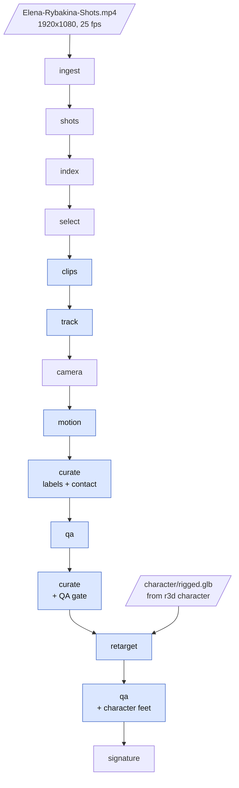

# Motion pipeline: footage to moveset

This document follows the motion lane of `rybakina3d` stage by stage, from the broadcast compilation to the
retargeted moveset (`anim/rybakina_moveset.glb` / `.fbx`), its quality report and the stroke signature. For
each stage it lists the inputs, outputs, models, the key algorithm, the constants that decide the result
(with their names in the code) and the known failure modes. The last sections give the numbers of the
current run and the reasons behind the main design decisions. Character creation (`r3d character …`, see
[character](character.md)) and the artwork stages (`r3d artwork …`, see [artwork](artwork.md)) are out of
scope here, except for the one place where the rigged character enters the retarget. Setup of the
workstation and the GPU host is in [setup](setup.md); the project overview is in the
[README](../README.md).

All paths below are relative to the project root; run outputs are relative to the run folder
`runs/rybakina/` (`run_dir` in `configs/rybakina.yaml`). The on-disk contract between stages is
`RunLayout` / `ClipLayout` in `src/rybakina3d/config.py`.

## Overview



Blue stages run on the GPU host through `r3d remote <stage>`, which pushes the code (`scripts/sync.sh`) and
the light run inputs, runs the stage over SSH and pulls the results back (`src/rybakina3d/remote.py`). The
others run on the workstation (hosted APIs, CPU work on the 720p previews), as in the
[README](../README.md#how-it-works) diagram.

| Stage | Runs on | Models / tools | Writes (under `runs/rybakina/`) |
|---|---|---|---|
| `ingest` | workstation | ffprobe, ffmpeg | `source/probe.json`, `source/audio16k.wav`, `source/proxy.mp4` |
| `shots` | workstation | PySceneDetect `AdaptiveDetector` | `shots.json` |
| `index` | workstation | Gemini `gemini-3.8-flash` (`models.index`) | `index/chunk_NN.json`, `index/index.json`, `index/upload.json` |
| `select` | workstation | librosa onsets, Gemini `gemini-3.8-flash` (`models.locate`) | `selection.json`, `index/locate.json` |
| `clips` | GPU host | ffmpeg | `clips/<id>/clip.json`, `clip.mp4`, `preview.mp4` |
| `track` | GPU host | Ultralytics YOLO11 (`yolo11x.pt`) + ByteTrack | `clips/<id>/track.npz`, `track.jpg` |
| `camera` | workstation | OpenCV + SciPy, ITF court model | `clips/<id>/camera.npz`, `camera.jpg` |
| `motion` | GPU host | GVHMR 1.6.1 (with its ViTPose preprocessing) | `clips/<id>/motion.npz`, `overlay.mp4`, `gvhmr/` |
| `curate` | GPU host | numpy | `curation.json`, contact written back to `clips/<id>/clip.json` |
| `qa` | GPU host | numpy | `clips/<id>/qa.json`, `qa_summary.json` |
| `retarget` | GPU host | Blender 5.2 (headless, `bpy` + numpy) | `anim/rybakina_moveset.glb`, `.fbx`, `retarget.json`, `verify.json`, `joints/`, `checks/` |
| `signature` | workstation | numpy | `signature.json` |

### Running it

```bash
scripts/run_pipeline.sh                    # every stage, motion lane included, in order
FROM=camera scripts/run_pipeline.sh        # resume from a stage (runs to the end, artwork and site included)

.venv/bin/r3d select --force               # one workstation stage
.venv/bin/r3d remote motion --clip serve_10m12s --force   # one GPU stage, one clip
.venv/bin/r3d camera --clip serve_10m12s --force
```

`scripts/run_pipeline.sh` runs `… select character clips track camera motion curate qa curate2 retarget qa2
signature …`. `curate` runs twice: the first pass fixes labels and contact frames from the motion (QA's
timing checks need the refined contact), `curate2` repeats it with the QA gate. `qa2` re-runs QA once the
character's joint tracks exist.

Skipping and forcing: `index select clips track camera motion` skip outputs that already exist and take
`--force`. `--clip <id>` (repeatable) limits `clips track camera motion` to those clips, and `retarget` to
their check renders (the moveset always holds every kept clip). `curate`, `qa` and `signature` rewrite their
outputs on every run.

### Inputs that are not in the repository

| Input | Where it goes | Notes |
|---|---|---|
| Broadcast compilation | `Elena-Rybakina-Shots.mp4` in the project root (`source.video`) | 30.8 min, 1920x1080, 25 fps, with audio. `*.mp4` is gitignored. `source.youtube` in the config records where it came from. |
| Rigged character | `runs/rybakina/character/rigged.glb` | Made by `r3d character refs / stylize / mesh` ([character](character.md)); needed by `retarget` only. `runs/` is gitignored. |
| GVHMR checkpoints, SMPL / SMPL-X body models | `weights/`, `body_models/` on the GPU host | Fetched by `scripts/setup_gpu.sh`. The body models carry their own research licences. |
| API keys, GPU host | `.env` | `GEMINI_API_KEY`; `R3D_HOST=user@gpu-host` (or `remote.host` in the config). Keys never leave the workstation. |

### Conventions

- **Frames.** Every cut is addressed by source frame index. A clip covers source frames
  `[start_frame, end_frame)`; per-clip arrays are indexed from 0 at `start_frame`. `contact_index` is the
  clip-local frame of racket-ball contact.
- **Rates.** The source is 25 fps. `clip.mp4` holds the same frames stamped at 30 fps (see `clips`);
  `preview.mp4`, `motion.npz` (`fps`), `overlay.mp4` and the exported animations run at 25 fps, one frame
  per source frame. QA thresholds expressed per frame are per source frame.
- **Pixels.** `clip.mp4` is source resolution (1920x1080), `preview.mp4` is 720p (1280x720). `camera.npz` and
  `motion.npz` intrinsics are in `clip.mp4` pixels.
- **World frames.** `camera.npz`: the court frame (metres, origin at the court centre, X across the court,
  Y along it away from the camera, Z up). `motion.npz`: GVHMR's gravity-aligned SMPL world, Y up, ground at
  y = 0; it is not the court frame. Retarget: Blender's Z-up world, every clip starting with the hips at
  the origin.
- **Clip ids.** `<stroke>_<MM>m<SS>s`, the stroke label plus the source timestamp of the contact (for
  example `serve_10m12s`).

## Stages

### 1. `ingest`: probe, audio, upload proxy

Code: `src/rybakina3d/footage.py`, `src/rybakina3d/media.py`. Command: `.venv/bin/r3d ingest`.

- **Reads:** `source.video`.
- **Writes:** `source/probe.json` (width, height, fps, frame count, duration, audio present),
  `source/audio16k.wav` (16 kHz mono PCM), `source/proxy.mp4` (360p H.264 at CRF 30, AAC 64 kb/s).
- **How:** ffprobe for the stream facts; ffmpeg for the audio track and a small proxy that keeps the
  audio (the strike sound helps Gemini place contact times). The proxy keeps the source frame rate, so its
  frame indices equal the source's.
- **Constants:** `index.proxy_height: 360`.
- **Behaviour:** `probe.json` is rewritten on every run; an existing audio track and proxy are kept.

### 2. `shots`: hard cuts

Code: `src/rybakina3d/footage.py` (`detect_shots`). Command: `.venv/bin/r3d shots`.

- **Reads:** `source/proxy.mp4`, `source/probe.json`.
- **Writes:** `shots.json`: `{fps, frames, shots: [{id, start_frame, end_frame, start, end}]}`.
- **How:** PySceneDetect's `AdaptiveDetector` on the proxy (same frames as the source, cheaper to decode),
  `auto_downscale` off.
- **Constants:** `shots.adaptive_threshold: 3.0`; `shots.min_shot_s: 0.6`, giving
  `min_scene_len = max(2, round(0.6 * fps))` = 15 frames at 25 fps.
- **Limitations:** dissolves and graphic wipes between shots are not hard cuts and may merge two shots;
  the labels and the selection then treat them as one.

### 3. `index`: Gemini shot labels

Code: `src/rybakina3d/index/labeler.py`, schema in `src/rybakina3d/index/schema.py`, client in
`src/rybakina3d/gemini.py`. Command: `.venv/bin/r3d index [--force]`.

- **Reads:** `shots.json`, `source/proxy.mp4`.
- **Writes:** `index/upload.json` (Gemini File API handle), `index/chunk_NN.json` (one cached response
  per window), `index/index.json`: `{model, shots: [label + start/end frames], missing, dropped_events}`.
- **Model:** `models.index: gemini-3.8-flash`, structured output (the Pydantic schema below), temperature
  0.2, `MEDIA_RESOLUTION_LOW`, up to 4 attempts with exponential back-off.
- **How:** the proxy is uploaded once (the handle is reused while the file is still active; files expire
  after about 48 h). The shot list is grouped into windows of at least `index.chunk_s` seconds without
  splitting a shot; each request covers one window, sampled at `index.fps`, and the prompt lists the shot
  ids and times inside it, so the model labels known intervals instead of inventing its own segmentation.
  Four windows are labelled in parallel. Gemini sometimes returns times relative to the window start:
  `_fix_time` accepts a time inside its shot (with 0.6 s of slack), else the time plus the window start,
  else drops the event (counted in `dropped_events`).
- **Schema (`ShotLabel`, one per shot):**

  | Field | Values |
  |---|---|
  | `view` | `main_broadcast` (high camera behind a baseline), `behind_low` (low camera behind the baseline), `side`, `closeup`, `other` |
  | `replay`, `slow_motion` | bool |
  | `rybakina_side` | `near` (half closest to the camera), `far`, `solo` (only she is in frame), `absent` |
  | `full_body` | her whole body visible for most of the shot |
  | `quality` | 1 to 5, usefulness for capturing her body motion (size, sharpness, occlusion, steady camera) |
  | `outfit` | a few words; reused by `select` to point Gemini at her |
  | `events` | `[{type, t, hitter, confidence}]`: `type` in `serve forehand backhand slice volley overhead celebration other`; `t` = racket-ball contact in seconds of the full video; `hitter` in `rybakina opponent unknown` |

- **Constants:** `index.chunk_s: 240`, `index.fps: 2.0`.
- **Limitations:** at 2 fps Gemini's contact times are coarse (the prompt asks for 0.1 s); `select` snaps
  them to the audio. Stroke type and hitter are model output and can be wrong; `curate` checks them
  against the recovered motion. `--force` deletes the chunk caches; the upload is still reused.

### 4. `select`: contact on the strike sound, hitter box, ranked windows

Code: `src/rybakina3d/selection.py`. Command: `.venv/bin/r3d select [--force]`.

- **Reads:** `index/index.json`, `source/audio16k.wav`, `source/probe.json`, the source video (contact
  frames at full resolution).
- **Writes:** `selection.json` (`{fps, clips, n_candidates}`), `index/locate.json` (hitter-box cache).
- **Model:** `models.locate: gemini-3.8-flash` on single JPEG frames.

**1. Candidates.** A shot qualifies when its `view` is in `select.allowed_views`, it is not a replay, not
slow motion (unless `select.allow_slow_motion`), `rybakina_side` is `near` or `solo`, `full_body` is true
and `quality >= select.min_quality`. Every event in it with `hitter == "rybakina"` and a type listed in
`select.strokes` is a candidate.

**2. Contact on the audio.** `Onsets` computes a spectral-flux onset envelope with librosa
(`hop_length=160` at 16 kHz = 10 ms, `n_fft=512`, `n_mels=40`, `fmin=1500` Hz: ball strikes sit above the
commentary band). Around Gemini's time it takes the strongest onset within `select.onset_search_s` and
z-scores it against the median and standard deviation of a ±3 s context (300 hops). If `z > 2.5` (and the
event is not a celebration) the contact frame becomes the onset (`contact_source: "audio"`), else it stays
at Gemini's time (`"gemini"`). The contact is clipped to `[shot_start_frame + 1, shot_end_frame - 2]`.

**3. Hitter box.** The full-resolution contact frame goes to Gemini with the stroke, handedness, backhand
type, the shot's outfit description and her court side; it returns `HitterBox {found, box_2d [ymin, xmin,
ymax, xmax] in 0..1000, full_body_visible, confidence}`. The box is converted to pixels (`hitter_box`, xyxy)
and its height is `hitter_height_px`, halved when the body is only partly visible (ranks it down).
Candidates without a box are dropped. The box is what identifies her among the people on court for
`track`. Results are cached per `shot_id:contact_frame` in `index/locate.json`; `--force` reuses that
cache.

**4. Window and score.** The window is `select.window_s[stroke]` (`[before, after]` seconds around
contact), clipped to the shot: `start = max(shot_start + 1, contact - round(before * fps))`,
`end = min(shot_end - 1, contact + round(after * fps) + 1)`. The score is

```
evidence = quality / 5 + size_score(hitter_height_px) + 0.5 * confidence + 0.3 * (contact_source == "audio")
score    = evidence * min(1, coverage)        # coverage = window length / wanted length; 0 if coverage < 0.6
size_score(h) = min(h / NEAR_PLAYER_PX, 1.5)  # NEAR_PLAYER_PX = 400, a near-court player's height at 1080p
```

**5. Quotas with over-generation.** Per stroke, the best `round(select.strokes[stroke] *
select.oversample)` candidates are taken by score, at most one per shot and stroke, and none whose contact
is within one second of an already chosen clip. Over-generating is deliberate: the recovered motion is a
stricter judge of the label than Gemini, and `curate` decides later.

| Config key | Value |
|---|---|
| `select.strokes` (kept clips per stroke) | serve 6, forehand 6, backhand 6, slice 2, volley 2, overhead 1, celebration 2 |
| `select.oversample` | 2.0 (so up to 12 / 12 / 12 / 4 / 4 / 2 / 4 candidates are cut) |
| `select.window_s` | serve [2.2, 1.0], celebration [0.6, 2.4], default [1.3, 1.0] seconds |
| `select.allowed_views` | `main_broadcast`, `behind_low`, `side` |
| `select.allow_slow_motion` | false |
| `select.min_quality` | 3 |
| `select.onset_search_s` | 0.5 |

- **Limitations:** the onset can lock onto the opponent's strike or a nearby bounce; offsets of 9 to 14
  frames were seen and are what `curate`'s search radius is sized for. Strokes of hers in far-court,
  close-up or replay shots are never candidates (see [the current run](#current-run)).

### 5. `clips`: frame-exact cuts

Code: `src/rybakina3d/clips.py`, `media.cut_frames`. Command: `.venv/bin/r3d remote clips [--clip <id>]
[--force]`.

- **Reads:** `selection.json`, the source video (on the GPU host; `scripts/sync.sh` does not copy it, so it
  has to be placed in the host's project root once).
- **Writes, per clip:**
  - `clip.mp4`: every source frame of the window exactly once, full resolution, H.264 CRF 16, no audio,
    stamped at `clips.model_fps` (30 fps). Model input for `track` and `motion`. Stays on the GPU host.
  - `preview.mp4`: the same frames at the true 25 fps, 720p (`clips.preview_height`), CRF 22, with audio.
    Review copy and the input of `camera`.
  - `clip.json`: the selection record plus `n_frames`, `src_fps`, `play_fps` (= 25), `model_fps`,
    `time_mode`, `contact_index`, `size`, `t_start`.
- **How:** ffmpeg seeks half a frame before `start_frame` (so the accurate seek lands on it) and copies
  `-frames:v n`. With `clips.time_mode: retime`, `setpts=N/(30*TB)` re-stamps the frames at 30 fps without
  dropping or duplicating any. The frame count of the result is probed and a mismatch is logged.
- **Why 30 fps:** GVHMR is trained on 30 fps video. Resampling 25 fps to 30 fps would duplicate one frame in
  five, which a temporal model sees as stalls. Re-stamping keeps each source frame once; the recovered
  motion is then used frame for frame and played back at 25 fps, so it stays aligned with the source and
  the preview.
- **Limitation:** GVHMR's temporal model sees the motion 1.2 times faster than real time. Poses are per
  frame and unaffected; whether the learned velocity priors are biased by the faster time base has not been
  measured.

### 6. `track`: her person track

Code: `src/rybakina3d/tracking.py`. Command: `.venv/bin/r3d remote track [--clip <id>] [--force]`.

- **Reads:** `clip.mp4`, `clip.json` (`hitter_box`, `contact_index`).
- **Writes:** `track.npz`: `bbx_xyxy (L,4)` float32 in `clip.mp4` pixels, `valid (L,)` (frame has a
  real detection), `track_id`, `coverage` (= mean of `valid`); `track.jpg` (contact frame with her box).
- **Models:** `track.detector: yolo11x.pt` (loaded from `weights/` if present, else fetched by
  Ultralytics), persons only, `track.conf: 0.25`, `imgsz=1280`, half precision, ByteTrack
  (`bytetrack.yaml`).
- **How:**
  1. *Lock.* For every ByteTrack id, take its box nearest the contact frame (within 6 frames) and score
     `IoU(box, hitter_box) * (1 - |f - contact| / 10) + 0.05 * track_length / n`. The best id wins if its
     score exceeds 0.15; otherwise the clip is skipped (no `track.npz`, so no motion).
  2. *Id-switch repair.* From the chosen track's first and last frames outwards, each frame without the id
     takes the detection that best overlaps the previous box (IoU > 0.3); the extension stops after 8
     consecutive misses. ByteTrack switches ids under fast motion, which this recovers.
  3. *Fill and smooth.* Remaining gaps are linearly interpolated (held at the clip ends) and all four box
     coordinates get a 5-frame moving average. GVHMR crops around these boxes.
- **Constants:** `track.min_coverage: 0.7` is only logged here; QA gates it.
- **Limitations:** the repair only works at the ends of the track; if ByteTrack hands her id to another
  person in the middle of the track, nothing detects it. Frames after the player is lost (whip pans, the
  player leaving the frame) get a held box, and GVHMR's motion there is a guess; `retarget` lists such
  frames as a warning.

### 7. `camera`: court-line calibration

Code: `src/rybakina3d/camera.py` (module docstring has the full method). Command:
`.venv/bin/r3d camera [--clip <id>] [--force]` (workstation; CPU only).

- **Reads:** `preview.mp4` (720p, frames 1:1 with `clip.mp4`), `track.npz` (player boxes to ignore),
  `clip.json`.
- **Writes:** `camera.npz` and `camera.jpg` (court model drawn over the start, contact and end frames;
  green = frame calibrated on its own lines, orange = interpolated). `r3d remote` pushes `camera.npz` to
  the host for `motion`.
- **Which clips:** only `CALIBRATED_VIEWS = ("main_broadcast", "behind_low")`. Side views are not attempted.

**Camera model.** Square pixels, principal point at the image centre, no skew, no lens distortion. Per
frame it solves 7 parameters: focal length `f` and the camera pose (rotation vector, translation) relative
to the court plane. With the fixed-centre bundle (step 6) a clip shares one optical centre and each frame
solves `f` and rotation only.

**Court model.** The ITF court: half length `HALF_LENGTH = 11.885`, half doubles width
`HALF_DOUBLES = 5.485`, half singles width `HALF_SINGLES = 4.115`, service line at `SERVICE_Y = 6.40` m
from the net; 9 painted lines at their centre lines (baselines 10 cm wide, others 5 cm): near baseline,
near and far service lines, far baseline, both doubles sidelines, both singles sidelines and the centre
service line.

**Method.**

1. *Line response:* white top-hat of the luminance (`TOPHAT_PX = 15`, wider than a line, narrower than
   logos and players) times a whiteness ramp on saturation (`SAT_MAX = 140`, `SAT_RAMP = 80`).
2. *Initialise:* Hough segments on the response mask (`MASK_MIN = 30`), merged into long lines; a
   near-horizontal family (tilt < 20 degrees, up to `MAX_HOR_LINES = 24`) and a steep family (tilt > 8
   degrees, up to `MAX_VER_LINES = 8`). Every ordered choice of 2 + 2 image lines against the 60 ordered
   2 + 2 model rectangles gives a homography, decomposed into `(f, R, t)`. Hypotheses must be physically
   plausible (`plausible`: camera 1 to 80 m above the court, at the near end, under 200 m from the centre,
   horizontal field of view within `HFOV_RANGE_DEG = (2.0, 75.0)`), are scored against the distance
   transform of the line mask and the best are snapped to every detected line they overlay.
3. *Refine:* sample the projected model lines every `SAMPLE_PX = 6` px, find the paint ridge along each
   normal to sub-pixel precision (`PEAK_MIN = 12`), minimise point-to-line distances (soft-L1) with a
   shrinking search band (`BANDS_INIT = (4, 4, 4, 3, 3, 2.5)` px, `BANDS_TRACK = (16, 8, 4, 2.5)` px).
4. *Verify a frame* (`frame_ok`): at least `MIN_MATCH_FRACTION = 0.65` of the visible, unoccluded model
   samples found paint; mean distance at most `MAX_FRAME_REPROJ_PX = 2.5` clip px; at least 2 lines of each
   family matched; no visible court line without its paint (`DEAD_LINE_FRACTION = 0.2`,
   `MAX_DEAD_LINES = 0`). Player boxes (padded) are excluded from matching.
5. *Track:* anchor on the best of five initialised frames (start, quarters, end), then track forwards and
   backwards from neighbouring solutions (constant-velocity and nearest-frame guesses), re-initialising
   every `REINIT_EVERY = 4` lost frames. A re-initialised frame must agree with the tracked camera:
   `|log f|` change below `MAX_ZOOM_JUMP = 0.25` and optical-centre change below `MAX_MOVE_JUMP_M = 3.0`.
6. *Clip bundle:* a main broadcast camera pans, tilts and zooms on a fixed head, so one optical centre per
   clip with per-frame focal length and rotation removes the focal/distance ambiguity of single frames
   (sparse least squares, two rounds). The bundle is kept only if no frame is lost and the mean error does
   not grow beyond `1.25 * free_error + 0.05`; low cameras behind the baseline ride on rails and keep free
   per-frame cameras.
7. *Interpolate* frames without their own fit (log focal length and rotation slerp, held at the ends), and
   convert to `clip.mp4` pixels: `preview.mp4` is a centre-aligned rescale, so with the principal point at
   the pixel-centre image centre only the focal length scales.

**Quality bar.** `camera.npz` is written only when at least `MIN_OK_FRACTION = 0.90` of the frames hold on
their own lines and the mean line reprojection over those frames is at most `MAX_CLIP_REPROJ_PX = 1.5`
clip px. A wrong camera is worse than GVHMR's default, so a clip below the bar gets no file, and a re-run
deletes a calibration that no longer passes.

**`camera.npz` contract** (L = clip frames; world = court frame):

| Key | Shape | Meaning |
|---|---|---|
| `K` | (L,3,3) | intrinsics in `clip.mp4` pixels |
| `R_w2c`, `t_w2c` | (L,3,3), (L,3) | `x_cam = R_w2c @ X_world + t_w2c` |
| `H_img2court` | (L,3,3) | `clip.mp4` pixels to court plane (X, Y) in metres |
| `ok` | (L,) | frame calibrated on its own lines (others interpolated) |
| `reproj_px` | (L,) | mean ridge-to-line distance, clip px (NaN without an own fit) |
| `method` | str | `court-lines/v2: ridge Hough init, point-to-line refine, fixed-centre clip bundle` |
| `centre` | (3,) | shared optical centre when the bundle was kept, else NaN |

- **Limitations:** side and close-up views have too little of the court in frame and are not attempted.
  No lens distortion is modelled. The file is written atomically (`camera.part.npz`, then renamed) because
  `r3d remote` may push it.

### 8. `motion`: world-grounded SMPL-X motion with GVHMR

Code: `src/rybakina3d/motion/recover.py`, skeleton in `src/rybakina3d/motion/smpl.py`. Command:
`.venv/bin/r3d remote motion [--clip <id>] [--force]`.

- **Reads:** `clip.mp4`, `track.npz`, `camera.npz` (if present), `clip.json`.
- **Writes:** `motion.npz` (contract below), `overlay.mp4` (projected skeleton over the clip, 720p,
  25 fps), `gvhmr/` (GVHMR's preprocessing cache; stays on the host). Clips without `track.npz` are
  skipped.
- **Model:** GVHMR 1.6.1 (`gvhmr.pipeline("human-motion-recovery")`), which runs its own ViTPose 2D
  keypoints and, for an uncalibrated moving camera, its own visual odometry.

GVHMR gets our inputs instead of its defaults:

| Input | What we pass | Why |
|---|---|---|
| Person boxes | `gvhmr/preprocess/bbx.pt` from `track.npz` (square crops enlarged by `base_enlarge=1.2`) | its largest-person tracker picks the wrong player |
| Intrinsics | per-frame `K` from `camera.npz`; without one, a focal length from the view's typical field of view (`VIEW_HFOV`: main_broadcast 38, behind_low 42, side 42 degrees) | a broadcast camera is a long zoom; one guessed focal length is wrong for most clips |
| Static or moving | calibrated: static if the camera turns less than `STATIC_ROT_DEG = 0.05` degrees and its optical centre moves less than `STATIC_SHIFT_M = 0.05` m over the clip; uncalibrated: static if the median background flow is below `motion.static_motion_px = 1.5` px/frame | decides whether GVHMR models camera motion |
| Camera rotation | calibrated and moving: `gvhmr/preprocess/slam_results.pt` with the per-frame `R_w2c` (rotation only, zero translation); uncalibrated and moving: GVHMR's visual odometry | the court gives the true pan/tilt |
| World path | `world_from_incam=False` for every clip | see below |
| Crop resolution | full resolution (`img_ds=1.0`, patched in `_full_res_crops`) instead of GVHMR's half-resolution decode | a near-court player is only about 250 px tall in broadcast |
| Flip test | `motion.flip_test: true` | test-time augmentation of GVHMR |

**World path choice.** For a static camera, GVHMR's wrapper by default rebuilds the world trajectory from
the in-camera translation. On broadcast footage that translation carries the monocular depth noise of a
small, distant player (about 0.1 px of size change per 10 cm of depth), and it shows up as 6 to 20 cm/frame
of foot skate. GVHMR's own world trajectory (velocity prior plus foot-contact post-processing) gives 0.2 to
0.5 cm/frame on the same clips, so it is used for every clip.

The background motion (`camera_motion_px`) is measured for every clip: Farneback optical flow on 480 px
wide grey frames, every second frame pair, with the player's box (padded) masked out; the median magnitude
in full-resolution pixels.

**`motion.npz` contract** (SMPL quantities Y up, metres; L = clip frames):

| Key | Shape | Meaning |
|---|---|---|
| `fps` | () | play rate = source fps (25); frames 1:1 with the source |
| `global_orient` | (L,3) | root rotation, axis-angle, world |
| `body_pose` | (L,63) | 21 SMPL-X body joints, axis-angle, local |
| `betas` | (10,) | shape, mean over the clip |
| `transl` | (L,3) | root translation |
| `joints_world` | (L,24,3) | SMPL joints in the world (ground at y = 0); indices in `motion/smpl.py` |
| `rest_joints` | (24,3) | zero-pose joints for `betas`, pelvis-relative |
| `static_conf` | (L,6) | P(static) for left ankle, left foot, right ankle, right foot, left wrist, right wrist |
| `joints_camera` | (L,24,3) | joints in the camera frame |
| `K` | (L,3,3) | intrinsics of `clip.mp4` |
| `kp2d` | (L,17,3) | ViTPose COCO-17 keypoints (x, y, confidence), `clip.mp4` pixels |
| `contact_index`, `stroke` | () | copied from `clip.json` at recovery time |
| `static_camera`, `camera_motion_px`, `f_px`, `calibrated` | () | how the camera was treated |
| `camera_rotation_deg`, `camera_shift_m` | () | rotation and centre travel over the clip (NaN without calibration) |

- **Limitations:** depth along the camera ray stays the weak axis; QA and the retarget treat it
  separately. For a calibrated camera that also travels (the rail cameras of `behind_low`), only its
  rotation reaches GVHMR; the travel is not modelled. The world frame is GVHMR's, not the court: the
  recovered motion does not know where on court she stands. `contact_index` inside `motion.npz` is the
  selected contact at recovery time; downstream stages read the refined one from `clip.json`.

### 9. `curate`: does the motion match the label?

Code: `src/rybakina3d/curate.py`. Command: `.venv/bin/r3d remote curate` (runs twice in
`scripts/run_pipeline.sh`).

- **Reads:** `motion.npz` (`joints_world`, `fps`), `clip.json`, `qa.json` (if present).
- **Writes:** `curation.json`: `{keep_all, kept, clips: [{id, stroke, ok, label_ok, score, qa,
  contact_index, measure, reason, kept}]}`; the refined contact back into `clip.json`.

**The checks** (`check`), on world joints, hitting hand from `athlete.handedness`:

| Stroke | Contact search | Check | Constant |
|---|---|---|---|
| serve, overhead | ±`SEARCH_OVERHEAD = 25` frames around the selected contact (it can sit about 20 frames early: the toss bounce or a late strike) | contact = the frame where the hitting wrist is highest above the head; the rise must be at least `OVERHEAD_MIN_RISE_M` | `OVERHEAD_MIN_RISE_M = 0.25` m |
| forehand, slice, volley | ±`SEARCH_GROUND = 14` frames (audio offsets of 9 to 14 frames were seen) | contact = peak pelvis-relative hitting-hand speed (5-frame median filter against single-frame glitches); the peak must be a real swing | `SWING_MIN_SPEED_MS = 4.0` m/s |
| backhand | same, two-handed: mean speed of both wrists | same | same |

Speeds are measured relative to the pelvis because the world root carries GVHMR's depth noise, not the
swing.

**Contact refinement.** A passing check moves `contact_index` to the refined frame and marks
`contact_source` with `+motion`; a failing check proves nothing about the contact and keeps the selected
one. The selected contact and its source are stored once as `contact_index_selected` /
`contact_source_selected`, and every run re-derives the contact from them, so curate is idempotent.

**Decision.** `ok = label_ok and QA gate != FAIL`. Clips are ranked per stroke by validity first, then by
`score = selection score + 0.5 * size_score - QA_PENALTY[gate]` (`QA_PENALTY = {PASS: 0.0, WARN: 0.3,
FAIL: 1.0}`, 0.5 for an unknown gate; a missing `qa.json` counts as PASS on the first pass). With
`curate.keep_all: true`, which `configs/rybakina.yaml` sets (the code default is false), every clip goes
into the moveset and failed checks are only flagged (`ok: false`, with a `reason`); otherwise the best
`select.strokes[stroke]` valid clips per stroke are kept and the rest dropped.

- **Limitations:** the checks are thresholds on one joint, not a stroke classifier: a return of serve
  labelled as a serve fails the wrist rise; a slow defensive groundstroke can fail the speed check while
  being a real stroke. A clip that fails is still animated under `keep_all` and is left out of the
  signature.

### 10. `qa`: quality metrics and the PASS / WARN / FAIL gate

Code: `src/rybakina3d/qa.py` (pure numpy; runs on either machine). Command: `.venv/bin/r3d remote qa`.

- **Reads:** `motion.npz`, `track.npz`, `clip.json` (the refined contact), `anim/joints/<id>.npz` (once
  retargeted).
- **Writes:** `clips/<id>/qa.json` (`{id, gate, status, metrics…, reasons, notes}`) and `qa_summary.json`
  (`thresholds`, `overall`, `by_stroke`, one row per clip, `missing_motion`, `errors`). A clip whose
  metrics cannot be computed gets a FAIL `qa.json`, so it never passes silently.

**Metrics.**

| Metric | Definition |
|---|---|
| skate | horizontal speed (cm/frame) of the four foot joints (ankles, feet) on steps where GVHMR calls the joint planted at both ends (`static_conf > CONTACT_P`); mean, p95, max. Each step is also split along and across the camera ray through that foot (per-frame camera rotation by Kabsch between `joints_world` and `joints_camera`; the ray, not the optical axis, so an off-centre player does not leak depth into the lateral part) |
| ground | sole height = foot joint height minus its rest height above the sole (`SOLE_OFFSET_M`: left/right ankle 0.071 / 0.063 m, feet 0.015 / 0.017 m); penetration below y = 0, floating while planted, the ground offset (median planted sole height) and the penetration left after re-grounding on that offset |
| jitter | mean norm of the third finite difference (m/s^3): all joints, wrists, the root alone, the pose relative to the root; plus the share of the root's jerk along the camera ray |
| reprojection | `joints_camera` projected with `K` against ViTPose keypoints with confidence > `KP_CONF`: median px, median / box height, PCK at `PCK_ALPHA` of the box height, per arms and legs. GVHMR is fitted to these same keypoints, so this checks consistency, not accuracy |
| timing | frame of peak pelvis-relative hitting-wrist speed minus the contact frame; `swing_speed_ms` = peak within `TIMING_FRAMES[1]` frames of contact; for serves the wrist apex offset as a second marker |
| tracking | `track.npz` coverage |
| camera | static, background motion, calibrated |
| retarget | skate of the character's feet (`anim/joints/<id>.npz`) on the same planted frames, per source frame; jitter of its root and of its pose relative to the root |

**Gate.** A clip's status is its worst rule. Thresholds are `(warn, fail)`:

| Rule | Constant | Warn | Fail |
|---|---|---|---|
| skate across the camera ray, mean | `SKATE_MEAN_CM` | > 1.5 cm/frame | > 3.0 cm/frame |
| skate across the camera ray, p95 | `SKATE_P95_CM` | > 4.0 | > 8.0 |
| total skate mean above 1.5 (reported with its depth share) | `SKATE_MEAN_CM[0]` | warn only | |
| fewer than `MIN_CONTACT_STEPS = 3` planted steps | | warn only | |
| ground offset (when `retarget.ground_from_contacts`) | `GROUND_OFFSET_CM = 8.0` | warn only | |
| penetration after re-grounding | `GROUND_PEN_CM = 5.0` | warn only | |
| pose jitter (relative to the pelvis) | `POSE_JITTER_MS3` | > 400 m/s^3 | > 800 |
| root jitter | `ROOT_JITTER_WARN_MS3 = 500` | warn only | |
| reprojection median / box height | `REPROJ_NORM` | > 0.06 | > 0.10 |
| PCK@0.1 | `PCK_MIN` | < 0.85 | < 0.65 |
| no confident 2D keypoints | | warn | |
| swing speed within 8 frames of contact | `SWING_MIN_MS` | < 3.0 m/s | < 2.0 m/s |
| peak wrist speed offset from contact | `TIMING_FRAMES` | > 3 frames | > 8 frames |
| track coverage | `track.min_coverage`, `COVERAGE_FAIL` | < 0.7 | < 0.5 |
| uncalibrated moving camera with background motion | `CAMERA_MOTION_WARN_PX = 8.0` | warn only | |
| retargeted skate mean / p95 | `SKATE_MEAN_CM`, `SKATE_P95_CM` | as above, on the full skate | |
| retargeted pose jitter | `POSE_JITTER_MS3` | > 400 | > 800 |
| retargeted root jitter | `ROOT_JITTER_WARN_MS3` | warn only | |
| retarget joint file without `names` / `positions`, or no foot joints recognised | | warn | |

Measurement conventions: `CONTACT_P = 0.5`, `KP_CONF = 0.5`, `PCK_ALPHA = 0.1`. Feet of the retargeted rig
are recognised by name (`RIG_FEET`: Meshy `LeftFoot LeftToeBase RightFoot RightToeBase`, or SMPL names).

Why the raw skate is gated across the ray only: the gate fails a clip only on what a root-depth fix
(GVHMR's own trajectory, court calibration, foot locking at retarget) cannot repair: skate across the ray,
pose jitter, 2D fit, timing, tracking. Depth-only problems warn. Once the retargeted feet exist, their skate
is gated in full.

- **Limitations:** the ground rules are measured on GVHMR's raw motion; the character's feet are held
  between 3 cm below and the float cap above the floor by the retarget itself (see below) and are not
  gated on height. Reprojection cannot catch a pose that is wrong in depth but consistent in 2D.
  `curation.json` records the gate of the QA pass before retarget (`curate2` runs before `qa2`); the
  final gate is in `qa_summary.json`.

### 11. `retarget`: SMPL motion onto the character rig in Blender

Code: driver `src/rybakina3d/assemble.py`; inside Blender `src/rybakina3d/blender/retarget.py` (pure numpy
half importable without Blender) and `src/rybakina3d/blender/racket.py`. Command:
`.venv/bin/r3d remote retarget [--clip <id>]`.

- **Reads:** `character/rigged.glb`, every kept clip's `motion.npz` (skipped with a log line if it lacks
  keys, has mismatched lengths or non-finite values: `motion_problem`), `clip.json`, `preview.mp4` and
  `track.npz` (check sheets).
- **Writes:** `anim/rybakina_moveset.glb`, `anim/rybakina_moveset.fbx`, `anim/retarget.json` (mapping,
  alignment angles, racket placement, per-clip grounding, skate before/after, warnings, GLB stats,
  verification, problems), `anim/verify.json`, `anim/joints/<id>.npz` (retargeted joint tracks for `qa`),
  `anim/checks/<id>_<frame>.jpg`, `anim/job.json`, `anim/blender.log`; `anim/rybakina_moveset.blend` stays
  on the host.
- **Tool:** Blender binary from `$R3D_BLENDER`, else `remote.blender` if it exists, else `blender` on the
  PATH; run as `blender -b --factory-startup --python-exit-code 1 --python retarget.py -- job.json`.

**Rig import.** The Meshy preview action and bone shapes are removed, and the armature's 0.01 object scale
(centimetre bones) is baked into the bones and the skinned mesh: Blender's glTF importer misplaces
bone-parented children (the racket) of a scaled armature, and engines expect a unit-scale skeleton.

**Bone mapping** (`map_bones`). SMPL joints are matched to rig bones by name vocabulary (Meshy, Mixamo,
Rigify `DEF-`, Unreal, Biped, generic; side tokens stripped); spine1 to spine3 are assigned along the
hierarchy between the pelvis and the neck. A mapping that breaks the SMPL parent order is dropped. Missing
pelvis, hips, knees, shoulders or elbows abort the stage.

**Rotation transfer with rest-pose alignment.** Per frame, `G_j` is the world rotation of SMPL joint `j`
(forward kinematics of `global_orient` / `body_pose`, converted from Y up to Z up). `A_j` is the minimal
rotation taking the rig bone's rest direction (its head to the mapped child's head) onto the SMPL T-pose
bone direction. The armature-space rotation of bone `b` mapped to `j` is `pose_b(t) = G_j(t) @ A_j @
rest_b`, and the pose-bone basis is `rest_rel^-1 @ parent_pose^-1 @ pose`. `A_j` is applied to the limbs
only (`ALIGN_JOINTS`: hips, knees, shoulders, elbows; wrists, head and feet reuse their parent's
alignment): there SMPL's T-pose and the rig's A-pose really differ, while trunk, collars and feet stand the
same way in both and their offsets only reflect where each skeleton puts its joints (aligning those would
pitch the head about 40 degrees down and lift the toes about 30 degrees). Unmapped bones keep their rest
pose relative to their parent. Rotations are keyed as quaternions made hemisphere-continuous and smoothed
with a Savitzky-Golay filter of `retarget.smooth_window = 5` frames (light, so swing peaks survive).

**Root path.**

1. The hips follow `joints_world[:, 0]` scaled by `leg_scale` (rig hip height over SMPL hip height, both
   above the ankles), starting at the origin.
2. Only the component along the median horizontal camera ray is smoothed: running median of
   `DEPTH_MEDIAN = 5` frames (pops), then Savitzky-Golay over `DEPTH_SMOOTH_WINDOW = 13` frames. Lateral
   motion is untouched.
3. Horizontal steps are clamped to `MAX_ROOT_SPEED = 8.0` m/s; steps above it are reported as "GVHMR root
   pops".
4. Light Savitzky-Golay smoothing (`smooth_window`), and the first frame is put back at the origin.

**Foot planting** (`plant_feet`, always on: `FOOT_LOCK = True`). With the rotations fixed, the feet
relative to the hips are known; the root path is then fitted to them. Horizontally, on a frame where a
foot joint is planted (`static_conf > CONTACT_THRESHOLD = 0.5`) on this and the previous frame, the root
moves so that the planted feet do not (averaged over them); otherwise it keeps the input step. Vertically
(`retarget.ground_from_contacts: true`), planted feet are put at their rest height and the correction is
interpolated through the flight phases between contacts (without any planted frame: one offset from the
lowest foot). Then the lowest foot joint is kept between `FLOOR_TOLERANCE_M = 0.03` m below its rest height
and a per-stroke float cap above it, `MAX_FLOAT_M = {serve: 0.5, overhead: 0.5, default: 0.05}` m: a
serve's jump needs room, while on groundstrokes GVHMR's root height is mostly depth drift.

**Racket.** A procedural low-poly racket (`racket.py`: 68.5 cm long, 33 x 26 cm head, 416 triangles) is
parented to the right-hand bone in an eastern forehand grip, placed at rest: `GRIP_ANGLE_DEG = 25`
(shaft from the hand's long axis towards the thumb), `PALM_OFFSET_M = 0.075` (wrist to palm centre),
`PALM_DEPTH_M = 0.015`, `GRIP_FROM_BUTT_M = 0.07`.

**Export.** One action per clip, named by the clip id, stored on muted NLA tracks so the rest pose stays
clean. GLB: all actions, sampled every frame, Y up, rest-position armature. FBX: every action baked, no
leaf bones, textures embedded, `-Z` forward, `Y` up. The scene runs at the clip rate (25 fps).

**Verification.** A second, fresh Blender process re-imports the GLB and checks (`verify_problems`):
action names equal the clip ids; each clip has the retargeted frame count and replays its joint track at
frames 0, contact and last within `JOINT_TOL_MM = 1.0`; the racket's parent is `BONE:<right hand>`; at
rest it sits within `RACKET_TOL_MM = 2.0` and `RACKET_TOL_DEG = 0.5` of where the build placed it; while a
clip plays it drifts on the hand by at most `DRIFT_TOL_MM = 1.0`. The FBX is re-imported for information
only. Any problem fails the stage. Inside the build, Blender's evaluated pose is also compared with the
numpy forward kinematics at the contact frame (`fk_error_mm`).

**Check sheets.** For each clip (or only the `--clip` ones): Workbench renders at the contact frame, plus
`EXTRA_CHECKS = {serve: (-20, -8, 0, 8), forehand: (-10, 0, 6)}` frame offsets. The broadcast camera of
each frame is recovered from GVHMR's world and camera joints (Kabsch) and moved with the foot-planting
shift; a side view looks across it at `SIDE_ELEVATION_DEG = 12`. Each sheet is `[preview frame |
character from the same camera | overlay at OVERLAY_ALPHA = 0.6 | side view]`, `PANEL = 360` px per panel.

- **Limitations:** no heel/toe IK: planted feet are pinned through the root only, and the lowest foot may
  dip up to 3 cm into the court by design. The racket is a rigid prop that follows GVHMR's wrist; racket
  face and forearm roll are not measured from the footage. The rig has no finger bones, so the grip is not
  articulated, and on two-handed backhands the left hand is not constrained to the handle. Every clip
  starts at the origin facing the same way; court position and the transitions between strokes are not
  part of the moveset.

### 12. `signature`: what makes the strokes hers

Code: `src/rybakina3d/signature.py`. Command: `.venv/bin/r3d signature` (workstation).

- **Reads:** `curation.json`, `motion.npz` (`joints_world`, `rest_joints`, `fps`), `clip.json` (refined
  `contact_index`).
- **Writes:** `signature.json`: `{per_clip: {id: features}, by_stroke: {stroke: {feature: {mean, sd},
  n}}}`.
- **Clips:** the kept clips whose motion passed `curate`'s stroke check (`label_ok`); a flagged clip, for
  example a return of serve labelled as a serve, would skew its stroke.

| Feature | Strokes | Definition (k = contact frame) |
|---|---|---|
| `contact_height` | all | hitting-wrist height above the ground at k, over standing height (rest head to ankle + 0.12 m crown); ground = lowest ankle in the clip - 0.08 m |
| `knee_flex_deg` | all | 180 minus the smallest knee angle (more bent knee) in the 1.2 s before contact |
| `hand_speed_ms` | all | peak world-frame hitting-wrist speed within k ± 3 frames (5-frame median filter) |
| `toss_above_head_m` | serve, overhead | toss-hand apex above the head in the 2.0 s before contact |
| `toss_to_contact_s` | serve, overhead | time from that apex to contact |
| `stance_width` | groundstrokes | horizontal ankle distance at k over leg length (hip to knee to ankle at rest) |
| `hip_shoulder_sep_deg` | groundstrokes | largest yaw difference between the shoulder line and the hip line in the 1.2 s before contact |

Heights are normalised by her standing height and widths by leg length, so the numbers compare across
clips and with another player's.

- **Limitations:** the measures inherit GVHMR's errors (depth, wrist orientation) and the refined contact;
  `hand_speed_ms` is in the world frame and includes root motion, unlike the pelvis-relative speeds of
  `curate` and `qa`. With one overhead clip its standard deviation is 0.

## Current run

Numbers from `runs/rybakina/` at the time of writing (2026-10-22). Every motion-lane stage of this run is
complete.

### From footage to candidates

| Step | Count |
|---|---|
| Compilation | 30.8 min, 46,198 frames, 1920x1080 at 25 fps |
| Shots (`shots`) | 283 (median 4.8 s, longest 28.7 s) |
| Labelled (`index`) | 283 of 283 in 8 windows; 447 events, 261 attributed to her (255 strokes, 6 celebrations); 68 events dropped as outside their shot |
| Excluded shots | 70 replays (34 in slow motion), 38 with her on the far court, 110 close-ups (overlapping) |
| Usable shots | 68 |
| Candidate events | 142: forehand 77, serve 33, backhand 29, overhead 2, slice 1 (no volley or celebration survives the filters) |
| With a hitter box | 124 |
| Selected, cut, tracked, recovered, retargeted | 39 |

Contacts: 38 of 39 snapped to the strike sound (onset z-scores 2.6 to 8.5); `slice_10m43s` kept Gemini's
time. `curate` moved the contact on all 24 clips that pass their stroke check, by a median of 5 frames
(0.2 s), at most 20 frames (`serve_16m13s`). Windows are 81 frames for serves and 58 for the other strokes,
shorter where the shot ends (`serve_27m12s` 75, `serve_04m57s` 80).

### Per stroke

| Stroke | Quota (x2) | Selected | Valid (`label_ok`) | Flagged | QA PASS / WARN / FAIL |
|---|---|---|---|---|---|
| serve | 6 (12) | 12 | 6 | 6 | 0 / 7 / 5 |
| forehand | 6 (12) | 12 | 8 | 4 | 4 / 5 / 3 |
| backhand | 6 (12) | 12 | 9 | 3 | 2 / 8 / 2 |
| slice | 2 (4) | 1 | 0 | 1 | 0 / 1 / 0 |
| overhead | 1 (2) | 2 | 1 | 1 | 1 / 1 / 0 |
| volley | 2 (4) | 0 | | | |
| celebration | 2 (4) | 0 | | | |
| **total** | | **39** | **24** | **15** | **7 / 22 / 10** |

`curate.keep_all` is true, so all 39 clips are in the moveset. The 15 flagged clips: six "serves" whose
hitting wrist never rises 0.25 m above the head near contact (-0.08 to +0.09 m; most likely returns of
serve), one overhead (-0.03 m), and eight groundstrokes whose hand speed near contact stays below 4 m/s
(1.3 to 3.3 m/s). All 10 QA FAILs are among them. The 24 valid clips are 7 PASS and 17 WARN.

### Camera and motion

- **Calibrated 38 of 39.** All 36 `main_broadcast` and both `behind_low` clips cleared the bar; the
  exception is `backhand_20m27s`, the only `side`-view clip, which is not attempted (`CALIBRATED_VIEWS`).
  Every frame of the 38 clips held on its own lines (2,473 of 2,473). Mean line reprojection per clip 0.19
  to 1.00 px (median 0.53) against the 1.5 px bar; horizontal field of view 22.4 to 51.0 degrees. The
  fixed-centre bundle was kept on the 36 main broadcast clips and rejected on the 2 `behind_low` clips
  (rail cameras).
- **Motion 39 of 39**, 38 on the court calibration. 32 clips ran as static cameras, 7 as moving: the 2
  `behind_low` clips (optical centre travels 1.0 and 2.8 m), 4 main broadcast clips that pan 0.05 to 0.48
  degrees, and `backhand_20m27s` (uncalibrated, background 6.6 px/frame, assumed 42 degree field of view,
  GVHMR's visual odometry).
- **Tracking:** median coverage 1.0; `forehand_26m50s` 0.69 (frames 40 to 57 untracked, QA WARN) and
  `backhand_10m16s` 0.72 (frames 42 to 57 untracked).

### QA (`qa_summary.json`, after retarget)

7 PASS, 22 WARN, 10 FAIL. Medians over the 39 clips:

| Metric | Median |
|---|---|
| foot skate, all / across the ray | 0.68 / 0.29 cm/frame |
| share of the skate along the camera ray | 65 % |
| retargeted foot skate | 0.11 cm/frame |
| pose jitter / root jitter | 251 / 186 m/s^3 |
| retargeted root jitter | 155 m/s^3 |
| reprojection | 5.6 px, 0.025 of the box height, PCK@0.1 0.999 |
| abs(peak wrist speed - contact) | 2 frames |
| swing speed near contact | 5.5 m/s |
| ground offset | 4.1 cm |

Reasons, counted per occurrence: every FAIL is a timing rule (peak wrist speed more than 8 frames from
contact on 10 clips, swing below 2 m/s on 5), all on flagged clips. The warnings are mostly GVHMR's ground
height (penetration after re-grounding on 21 clips, ground offset on 11; for 10 clips these are the only
warnings), then the timing rules (7), fewer than 3 planted steps (5), total skate above 1.5 cm/frame with
the part across the ray under the bar (3; 33 to 95 % of it along the ray), pose jitter above 400 m/s^3 (3)
and track coverage (1).

### Retarget

- 39 animations in `anim/rybakina_moveset.glb` (8.44 MB, 25,004 triangles = character 24,588 + racket
  416, 1 skin, 24 bones) and `.fbx` (15.16 MB); Blender 5.2.2 LTS, 17 s.
- 22 of 22 SMPL joints mapped; unmapped rig bones `head_end`, `headfront`. Rest angles between the rig's
  A-pose and SMPL's T-pose: shoulders 52 to 54 degrees, elbows 56 to 58 degrees (aligned); leg scale 0.98
  to 1.10.
- Grounded from contacts on all 39 clips. Character foot skate on planted frames, median 1.07 before and
  0.11 cm/frame after planting (max 0.56); lowest foot at the 5th percentile, median -3.0 cm (the floor
  tolerance). The float cap held the root down on 22 clips (1 to 18 frames each). No root pops above
  8 m/s.
- Verification: action names match, joint replay error at most 0.011 mm, racket at rest 0.1 mm / 0.02
  degrees from its placement, no drift on the hand; the FBX re-import lists the 39 actions (as
  `Armature|Armature|<id>`) with the same racket placement. 99 check sheets in `anim/checks/`.

### Signature (`signature.json`, 24 valid clips)

| Stroke | n | Contact height (x height) | Knee flex (deg) | Hand speed (m/s) | Other |
|---|---|---|---|---|---|
| serve | 6 | 1.27 ± 0.06 | 78 ± 5 | 5.9 ± 0.5 | toss 0.42 ± 0.01 m above the head, 0.73 ± 0.17 s before contact |
| forehand | 8 | 0.63 ± 0.13 | 92 ± 10 | 6.5 ± 1.3 | stance 1.04 ± 0.17 leg lengths, hip-shoulder separation 38 ± 10 deg |
| backhand | 9 | 0.63 ± 0.14 | 98 ± 9 | 5.7 ± 1.0 | stance 0.86 ± 0.16 leg lengths, separation 40 ± 12 deg |
| overhead | 1 | 1.20 | 88 | 6.2 | toss-hand apex 0.33 m above the head, 0.84 s before contact |

## Why these choices

Decisions recorded in the code comments, in pipeline order:

- **Label known intervals.** Shots are detected first and Gemini labels them by id, so labels line up
  with frame-exact cut points instead of the model's own segmentation (`index/labeler.py`).
- **The strike sound fixes contact.** A ball strike is a sharp, high-frequency onset; above 1.5 kHz it
  stands out from commentary, and it is far more precise than a 2 fps video model (`selection.py`).
- **Identify her once, on the contact frame.** Gemini's box on the contact frame picks her among the
  players; YOLO + ByteTrack then follow that person. GVHMR's own largest-person tracker picks the wrong
  player (`tracking.py`, `motion/recover.py`).
- **Over-generate, then let the motion judge.** Twice the quota is cut and recovered; the recovered 3D
  motion rejects labels it contradicts (`selection.py`, `curate.py`).
- **Re-stamp, do not resample.** GVHMR expects 30 fps; re-stamping keeps every source frame once, so the
  motion stays frame-aligned with the source (`clips.py`).
- **Calibrate the camera from the court, strictly.** A broadcast camera is a long zoom on a pan/tilt head;
  the court is a known planar model, so it fixes the focal length and pose per frame. A wrong camera is
  worse than GVHMR's default, hence the 90 % / 1.5 px bar (`camera.py`).
- **One optical centre per clip when it fits.** A fixed head removes the focal/distance ambiguity of
  single frames; rail cameras are detected by the fit getting worse and keep free cameras (`camera.py`).
- **GVHMR's own world path.** The in-camera translation carries monocular depth noise into the world path
  (6 to 20 cm/frame of foot skate on this footage, 0.2 to 0.5 without it) (`motion/recover.py`).
- **Full-resolution crops.** A near-court player is only about 250 px tall (`motion/recover.py`).
- **Pelvis-relative speeds.** The world root carries depth noise, not the swing (`curate.py`, `qa.py`).
- **Gate what cannot be repaired downstream.** Depth-only skate and root jerk warn; lateral skate, pose
  jitter, 2D fit, timing and tracking can fail (`qa.py`).
- **Align limbs only.** Trunk and feet stand the same way in both rest poses; aligning them would tilt the
  head and toes (`blender/retarget.py`).
- **Smooth depth only, along the ray.** The root's noise is mostly along the camera ray; lateral motion is
  kept (`blender/retarget.py`).
- **Bake the armature scale.** Blender's glTF importer misplaces bone-parented children of a scaled
  armature, and engines expect unit scale (`blender/retarget.py`).
- **Prove the exported files.** A fresh Blender re-imports the GLB (and FBX) and replays it against the
  joint tracks QA measured, instead of trusting the in-memory scene (`assemble.py`).
- **Keep every clip, flag the doubtful ones.** Review wants her full range of movement, so with
  `curate.keep_all` every clip is animated and failed checks are flagged; the signature only uses clips
  that pass (`configs/rybakina.yaml`, `signature.py`).

## Tests

`.venv/bin/pytest -q` (164 tests at the time of writing; no GPU, Blender, API key or private input needed, see
[architecture](architecture.md#tests)). Motion-lane coverage:

| File | Covers |
|---|---|
| `tests/test_core.py` | IoU, box fill and smoothing, index windows and time fix, SMPL FK and joint indices, `size_score` |
| `tests/test_selection.py` | audio onset refinement on a synthetic strike |
| `tests/test_camera.py` | court model, homography decomposition, calibration of synthetic broadcast frames, fixed-centre zoom tracking, the `camera.npz` contract |
| `tests/test_curate.py` | serve apex, groundstroke speed peak, rejections, idempotent contact refinement |
| `tests/test_qa.py` | every metric and the gate rules, retarget skate per source frame, unreadable clips |
| `tests/test_retarget_math.py` | rotation helpers, bone mapping across naming schemes, rotation transfer, grounding, foot planting, depth smoothing, camera recovery |
| `tests/test_retarget_driver.py` | `motion_problem`, check frames, re-import verification |
